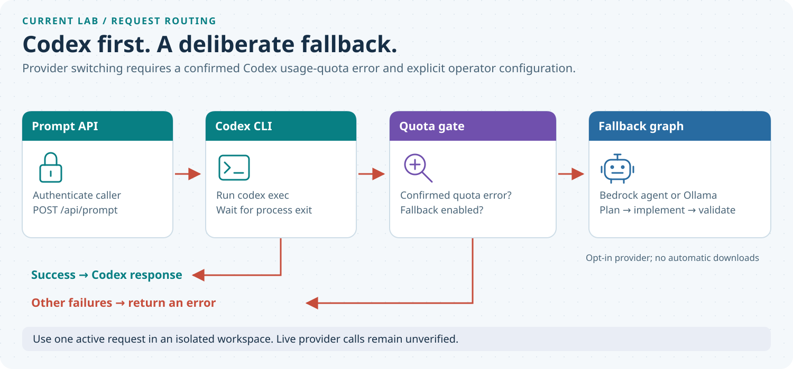
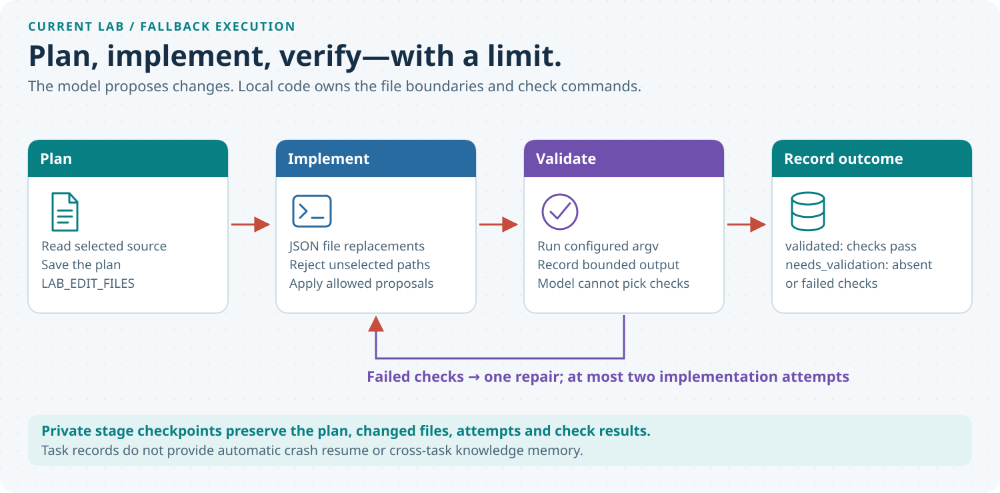

# Codex with a quota fallback for personal use: a tiny hybrid agent harness

## The use case

- Use Codex for everyday coding tasks in personal projects.
- If its usage quota is exhausted, explicitly enable an existing Bedrock agent or
  an already-running local Ollama model as a continuity option.
- Share only selected files, accept bounded change proposals and run your own
  checks. Failed checks permit one repair.
- Review the result yourself. This is a small personal lab, not a production
  multi-user service or a seamless continuation of Codex’s conversation.

## How a request moves

The prompt API tries Codex first and waits for its process to finish. A normal
response returns directly. Only a recognized usage-quota error can activate the
opt-in fallback; authentication, network and ordinary execution errors remain
errors. Demo mode never activates fallback.

<p align="center">
  
</p>

## Keep the alternate workflow small

The same LangGraph sequence serves either fallback provider:

1. **Plan:** read only the files selected in `LAB_EDIT_FILES` and save the plan.
2. **Implement:** accept JSON file replacements, reject unselected paths and apply
   allowed proposals. The model does not choose shell commands.
3. **Validate:** run operator-configured argv commands independently of the
   model’s claim. Failed checks allow one repair, with two implementation attempts
   at most.
4. **Record:** retain the plan, changed files, attempts and check results in a
   private task checkpoint outside the workspace.

<p align="center">
  
</p>

Passing every configured check produces `validated`. Missing checks or checks
still failing at the attempt limit produce `needs_validation`. Passing checks
shows that those commands passed; review whether they cover the actual task.

## Current scope

Use one active request in an isolated workspace. The file allowlist is not an
operating-system sandbox. Selected source and bounded check output are shared
with the configured provider, so select files appropriate for that destination.

Checkpoints are task records. Automatic crash resume, cross-task knowledge memory
and transfer of an interrupted Codex thread are not implemented. The optional
standalone prompt classifier is separate from this Codex-first path.

These diagrams describe the current local source. Live Bedrock and Ollama calls
remain unverified; this documentation update does not establish end-to-end
provider execution.

## Code, files and installation references

Browse the [GitHub repository](https://github.com/gopalcb/deep-agent-harness-with-codex)
for the code and configuration below.

| File | Responsibility |
| --- | --- |
| [`codex/api.py`](https://github.com/gopalcb/deep-agent-harness-with-codex/blob/main/codex/api.py) | Prompt API, live-request authentication and Codex CLI execution |
| [`codex/fallback.py`](https://github.com/gopalcb/deep-agent-harness-with-codex/blob/main/codex/fallback.py) | Quota recognition, provider configuration and private checkpoints |
| [`deep-agents/workflow.py`](https://github.com/gopalcb/deep-agent-harness-with-codex/blob/main/deep-agents/workflow.py) | Plan, implement, validate, selected-file writes and one repair |
| [`deep-agents/routing.py`](https://github.com/gopalcb/deep-agent-harness-with-codex/blob/main/deep-agents/routing.py), [`deep-agents/api.py`](https://github.com/gopalcb/deep-agent-harness-with-codex/blob/main/deep-agents/api.py) | Optional standalone classifier; bypassed by the normal path |
| [`codex/pyproject.toml`](https://github.com/gopalcb/deep-agent-harness-with-codex/blob/main/codex/pyproject.toml) | Prompt API and fallback dependency declarations |
| [`deep-agents/pyproject.toml`](https://github.com/gopalcb/deep-agent-harness-with-codex/blob/main/deep-agents/pyproject.toml) | Optional classifier dependency declarations |
| [`.env.example`](https://github.com/gopalcb/deep-agent-harness-with-codex/blob/main/.env.example) | Nonsecret configuration examples; not loaded automatically |
| [`guide/illustrated-guide.html`](https://github.com/gopalcb/deep-agent-harness-with-codex/blob/main/guide/illustrated-guide.html) | Offline HTML companion with both diagrams embedded |
| [`deep-agents/WORKFLOW.md`](https://github.com/gopalcb/deep-agent-harness-with-codex/blob/main/deep-agents/WORKFLOW.md) | Current fallback workflow configuration |
| [`ARCHITECTURE.md`](https://github.com/gopalcb/deep-agent-harness-with-codex/blob/main/ARCHITECTURE.md) | Current architecture and boundaries |
| [`LICENSE`](https://github.com/gopalcb/deep-agent-harness-with-codex/blob/main/LICENSE) | MIT license |

### Install and run locally

Use Python 3.11 or newer, `uv`, and the shared `../.venv` environment. If that
environment does not exist, create it once with
`uv venv --python 3.12 ../.venv`. Run these commands from the repository root:

```bash
uv pip install --python ../.venv/bin/python \
  'fastapi>=0.115' 'uvicorn>=0.30' 'httpx>=0.28' \
  'boto3>=1.40' 'langgraph>=1.0'

../.venv/bin/python -m uvicorn api:app \
  --app-dir codex --host 127.0.0.1 --port 3100
```

This installs the dependencies declared by [`codex/pyproject.toml`](https://github.com/gopalcb/deep-agent-harness-with-codex/blob/main/codex/pyproject.toml); it does not
install or start Ollama, download a model or provision a Bedrock agent. The
optional classifier’s `deepagents` dependency is not needed for this request path.

The application defaults to demo mode. For real Codex execution, install and
privately authenticate the Codex CLI, set `LAB_MODE=live` and configure
`LAB_BROWSER_TOKEN` in the server environment. Export settings explicitly; the
application does not load dotenv files automatically.

For fallback, choose `LAB_FALLBACK_PROVIDER=bedrock` or `local` and enable the
existing master switch `LAB_BEDROCK_ENABLED=true` for either provider. Set
`LAB_WORKSPACE`, an external `LAB_CHECKPOINT_DIR`, `LAB_EDIT_FILES` and trusted
`LAB_VALIDATION_COMMANDS`. Bedrock also needs an existing agent ID, alias, region
and authorized AWS credentials through the normal SDK chain; local mode needs an
already-running Ollama service and `LAB_LOCAL_MODEL`.
