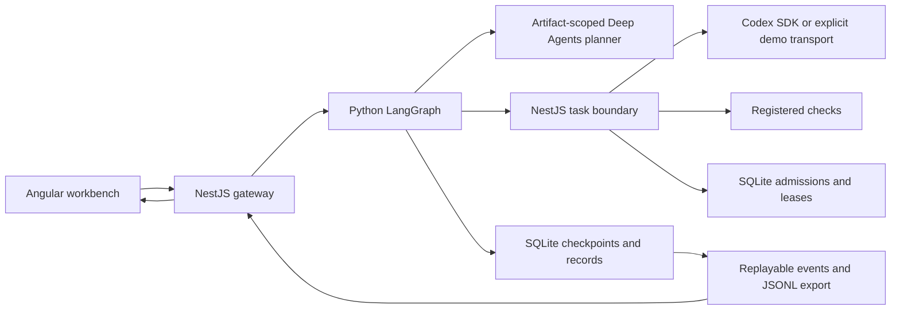

---

# Codex-first harness implementation and verification

The project now contains a runnable, credential-free engineering lab with an Angular workbench, a NestJS-owned Codex SDK boundary, and a durable Python LangGraph coordinator. Direct and planned workflows cross the actual local HTTP boundary, execute disposable fixture changes, run registered checks, and expose correlated progress in the UI. Local automated checks and scoped browser observations support this result; live Codex/model execution, private MCP/document acceptance, and migration into the existing controller remain unverified.

This summary covers the reviewed implementation in this directory. The [original blueprint](../langgraph_multi_agent_harness_with_codex_engineering_lab_revised.md) is preserved. The [reviewed plan](implementation-plan.md), [work-item evidence](deep-agent-harness-work-items.md), [frozen interfaces](contracts.md), [architecture](../ARCHITECTURE.md), [design checklist](../DESIGN.md), and [README](../README.md) describe the delivered contracts and operating limits. `.env.example` supplies configuration names without live credentials.

## What was delivered

The coordinator decides task order and checks outcomes; NestJS owns coding execution and thread mappings. Deep Agents handles planning and bounded research against isolated artifacts. It does not gain a second repository editor or shell. The demo uses explicit deterministic planning/execution transports, so success does not imply that a model was contacted.

Angular sends requests to the same-origin NestJS gateway. Python admits a scoped run, produces either one direct assignment or a validated dependency graph, and dispatches typed tasks back to NestJS. NestJS journals admissions and workspace ownership before invoking its transport, runs configured checks, and returns explicit evidence. Python advances dependencies, requests bounded repair where needed, and makes verified outcomes available as memory candidates.

| Area | Delivered behavior | Main source paths |
| --- | --- | --- |
| Contracts and configuration | Strict request/task/result models; server-owned workspace and check policy; locked Node and uv dependency sets | `services/agent-orchestrator/src/orchestrator/contracts.py`, `config.py`, `validation.py`; `services/control-plane/src/contracts.ts`; lockfiles |
| Durable workflow | Real LangGraph direct/planned execution; DAG validation; checkpointing; write-ahead dispatch; restart reconciliation; approvals; cancellation; bounded same-thread repair | `workflow.py`, `routing.py`, `api.py`, `codex_client.py`, `workspaces.py` |
| Planning and context | Real Deep Agents construction; structured task plans; bounded read-only research subagent; trusted sample skills; isolated planning artifacts; SDK summarization and final prompt guard | `planning.py`, `context.py`, `skills/research/`, `skills/documentation/` |
| Execution owner | NestJS-only SDK construction; start/status/resume/cancel/events; durable admission and thread mapping; authoritative leases; registered argv checks; disposable demo workspace | `services/control-plane/src/execution.ts`, `store.ts`, `main.ts` |
| Events and state | Project/run-scoped SQLite records; atomic claims; deduplicated ordered replay; secret redaction; rotating JSONL export rebuilt from SQLite | `storage.py`, `events.py` |
| Memory | Candidates retain provenance, evidence and expiry; explicit review and passed sourced evidence required for promotion; invalidated/expired knowledge excluded | `memory.py`, `tools.py`, `workflow.py` |
| Optional integrations | Authenticated, explicit scoped publication, reconciliation, search and MCP routes; permissions default to deny; configured endpoints and per-agent tool allowlists | `documents.py`, `tools.py`, `integrations.py`, `integration_routes.py` |
| Workbench | Direct/planned request form, optional visual target, task dependencies/status/checks/thread/artifacts, approval controls, cancellation, filtered replayable timeline and actionable errors | `apps/lab-ui/src/main.ts`, `styles.css`, `index.html` |

Paths without a directory prefix in the table are under `services/agent-orchestrator/src/orchestrator/`.

## Requirement coverage and acceptance boundaries

| Requirement from the revised blueprint/plan | Status | Evidence and limit |
| --- | --- | --- |
| Preserve Codex as coding harness and NestJS as execution owner | Implemented locally | Python uses HTTP; the TypeScript SDK adapter compiles. No Python Codex SDK or attachment to sibling sessions was introduced. Live authentication is untested. |
| Python + uv coordinator and typed graph | Implemented and locally tested | Locked dependency environment, strict models, direct/planned graph tests, and real local HTTP integration. |
| Task dependencies, verification and repair | Implemented serially | Planned fixture has `implement → verify`; invalid DAGs fail; missing/failed checks cannot establish success; repair uses the existing thread and stops at the configured bounded policy. |
| Durable checkpoints and safe resumption | Implemented for supported local topology | Restart/idempotency tests exercise reconciliation rather than duplicate dispatch. Coordinator checkpoints and execution journals are separate authorities for their respective state. |
| Approvals and cancellation | Implemented with a restricted executor | Approval binds the exact assignment action/revision; denial prevents dispatch. Protected operations remain rejected by NestJS even after approval because a dedicated protected executor is not delivered. |
| Unified local observability | Implemented and locally tested | Correlated workflow/task/agent/thread events, observed durations, replay cursors, deduplication, redaction and JSONL rotation/rebuild. This is application telemetry, not a full copy of Codex internals. |
| Deep Agents SDK, tools and skills | Implemented with fake-model tests | Tests invoke the real SDK harness with injected offline model behavior and inspect scoped tools, actual sample-skill loading, artifact containment and event correlation. No live model entitlement is established. |
| 70% Python context policy | Implemented as an estimate and locally tested | Actual model-call middleware counts system prompt, messages and tool schemas after SDK summarization/offloading; oversized inputs are refused. Token estimates are not provider-measured occupancy. |
| Scoped memory and reviewed promotion | Implemented locally | Verified task outcomes become candidates; failed/unverified outcomes do not. Promotion is separate and evidence-gated. No automatic long-term promotion or global skill installation occurs. |
| MCP and Markdown service integration | Adapter and explicit API paths implemented; live acceptance pending | Fake authenticated services cover scope, allowlists, receipt checks and uncertain-write reconciliation. Demo startup does not enable external calls. |
| Existing Angular/NestJS controller integration | Deferred explicitly | Audit found a sibling `codex app-server` owner rather than the assumed SDK task boundary. This standalone lab does not migrate or replace that owner or its sessions. |
| Parallel worktree engineering and merge integration | Not implemented | Graph execution starts serially. Node can admit independent registered workspace roots, but worktree creation, branch integration and conflict resolution need additional implementation and tests. |
| PostgreSQL checkpoint backend | Dependency available; backend not implemented | Local service constructs SQLite checkpointing. README explains the construction/lifecycle/schema work needed before PostgreSQL can be claimed. |
| Complete live visual request → models → private publication → promoted memory | Not verified | Local demo and mocked adapter segments passed separately; no live end-to-end provider/private-service acceptance was run. |

## Verification evidence

The main agent and independent validation agent performed the checks below before this summary assignment. This summary agent inspected the current documentation, contracts, source modules and relevant test cases; it did not independently rerun the implementation suites. Counts below refer to their reported execution evidence, rather than inferred success from test names.

| Check | Command or method | Reported result | Scope |
| --- | --- | --- | --- |
| Locked Python environment | `uv sync --locked --project services/agent-orchestrator` | Passed | Dependency lock consistency and local environment installation |
| Python behavior | `uv run --project services/agent-orchestrator pytest services/agent-orchestrator/tests -q` | Independent validation: 54 passed; main final run: 55 passed in 3.52 s | Final run adds authenticated/default-deny integration-route regression; graph, persistence, memory, context and adapter checks use offline external transports |
| Python lint | `uv run --project services/agent-orchestrator ruff check services/agent-orchestrator/src services/agent-orchestrator/tests` | All checks passed | Entire current Python source/test scope |
| Node execution behavior | `npm test` | 7 passed | Admission, scoping, verification, same-thread resume, cancellation, restart leases, path containment and trusted artifacts |
| Application build | `npm run build` | Passed | NestJS/TypeScript SDK compilation and Angular build; no live SDK invocation |
| Cross-service integration | `npm run test:integration` | Final main run: 1 passed in 7.47 s | Actual local HTTP services, direct/planned fixture execution, checks, auth, idempotency, approval denial and replay |
| Production dependency audit | `npm audit --omit=dev` | 0 vulnerabilities reported | npm's audit result for the installed production dependency scope; not a general security guarantee |
| Desktop browser | Main-agent Computer Use session | Direct workflow succeeded | Checks, thread reference and timeline observed; missing favicon observed and repaired |
| Additional browser checks | Supplementary Playwright observations | Planned implement/verify flow passed with 23 events; approval denial passed | Browser supplement to Computer Use; does not establish the complete required two-cycle stability procedure |
| Narrow viewport | Supplementary browser measurement at 390 px | `scrollWidth = 390`, no horizontal overflow; measured button height 45 px | One observed viewport, not an exhaustive accessibility or device audit |

Main reported cleanup of all owned demo processes, closure of the controlled Computer Use window with the regular user window restored, and closure of the supplementary Playwright session with no tabs remaining. An unrelated pre-existing Softrobots test browser was preserved. Final source/diff inspection remains the main agent's integration responsibility. No push, merge, code deployment or live deployment smoke test is part of this delivery.

Independent validation identified four correctness/security findings and verified their repairs:

1. **Unverified evidence could become memory candidates.** Candidate creation now requires a successful task and nonempty passed check evidence, retaining the original sources without automatic promotion.
2. **Parent and nested workspace writers could overlap.** Lease admission rejects ancestor/descendant overlaps in both directions while allowing separate roots.
3. **A model-controlled artifact symlink could redirect trusted output.** Trusted collection ignores workspace `.artifacts` redirection, and live configuration rejects journals/artifacts inside writable model workspaces.
4. **History could starve active scheduling and truncate terminal telemetry.** Scheduling filters terminal history and rotates active work; terminal runs continue draining paginated execution events without redispatching tasks. The regression covers history beyond the previous 100-run boundary.

Additional tests preserve bounded untrusted visual target context and workflow identity/durations across planned events. These checks support the local behavior described here, not unrestricted hostile deployment safety.

## Agent sequence and context accounting

The separate summary stage followed implementation, main-agent validation and independent validation. Native roles below identify the configured delegated models; no main-thread runtime model is asserted.

| Order | Agent | Role/model/effort | Responsibility and handoff |
| --- | --- | --- | --- |
| 1 | `/root/plan` | `high_effort`: `gpt-6-astra`, high | Read-only specification/controller audit and detailed planning. Main waited for its result. |
| 2 | `/root/plan_review` | `high_effort`: `gpt-6-astra`, high | Reviewed the plan and reliability boundaries before implementation. |
| 3 | `/root/graph` | `medium_effort`: `gpt-6.1-sol`, medium | Owned graph, planning, context, HTTP client/routes and related tests. |
| 3 | `/root/persistence` | `medium_effort`: `gpt-6.1-sol`, medium | Owned SQLite/event persistence, memory, tools/publication and related tests; worked in parallel with graph implementation. |
| 3–4 | `/root` | Main conversation; runtime model not asserted | Built shared contracts, NestJS/Angular, integration checks and shared documentation; integrated worker results and repaired findings. |
| 5 | `/root/validation` | `high_effort`: `gpt-6-astra`, high | Independent source/test validation, four findings, and verification of repairs. |
| 6 | `/root/summary` | `medium_effort`: `gpt-6.1-sol`, medium | Wrote this document after validation with ownership limited to this summary. |
| 7 | `/root` | Main conversation | Final summary/diff inspection and document delivery. |

All native agents' context percentages and manual compaction status are **unknown**: this session exposes neither percentage telemetry nor a manual compaction control. Bounded fresh assignments and concise handoffs were used. There is no evidence that native-agent compaction actually occurred, and cumulative usage must not be presented as current context occupancy.

That limitation is separate from the application's implemented policy. `ContextBudgetMiddleware` estimates serialized UTF-8 bytes divided by two, reserves output/headroom, and applies `floor((capacity - reserve) × 0.70)`. It counts final system/messages/tool schemas before each guarded model call. SDK summarization/offloading runs first; tests demonstrate an actual SDK history artifact and bounded downstream prompt, as well as refusal when the prompt remains oversized. Offload events require an observed history-file revision and digest. This proves the local application path with an injected model, not native Codex compaction telemetry or a tokenizer-exact provider guarantee.

## Deviations, operating limits and next actions

The material architecture deviation is the standalone boundary: the audited sibling owns an app-server subprocess, so mounting an SDK owner into it would require an explicit transport/session migration. That migration was kept outside this directory. The implementation also uses serial graph execution and SQLite rather than claiming worktree merging or a working PostgreSQL backend.

The supported topology is one Python coordinator process and one NestJS execution owner per state database/workspace root. Local process locks do not establish distributed scheduler safety. An interrupted external invocation retains its lease as uncertain; an operator must reconcile it before replay or release. SQLite is authoritative for replay; JSONL is a derived export and currently rebuilds complete history on append, which is a scale limitation.

Before live use, configure real workspace roots and registered checks, explicit live planner/provider configuration, approved Codex authentication, matching internal/browser credentials and trusted integration endpoints. The default `fixture` check belongs to demo mode; real repository plans/contracts need matching configured check IDs. Keep browser/internal secrets separated. The document adapter's POST/search/receipt schema is a lab contract and must be mapped to the deployed service's actual contract before use. A timeout or mismatched receipt remains uncertain and must be reconciled without blind resubmission.

Future implementation work includes controller transport migration with session/visual-selection regressions, worktree creation and conflict-safe integration, PostgreSQL lifecycle/concurrency support, and any protected executor. Future acceptance work includes live Codex/model and private MCP/document calls, the complete cross-provider publication/memory path, and the full two-cycle browser stability procedure. These are distinct from the locally completed lab.

For a small local learning check, run the README demo and compare Direct with Planned: Direct should show one assignment, while Planned should expose `implement` before `verify`. A sensitive request should wait for a decision; denying it must prevent dispatch. Approving it does not implement the missing protected executor. This is a practical way to distinguish orchestration policy from execution capability.

## Document and remote work-item status

The scoped delivery ledger at `.codex/document-delivery/receipts.json` records the reviewed plan's exact submitted revision:

| Field | Recorded value |
| --- | --- |
| Local path | `docs/implementation-plan.md` |
| Classification | `workflow-docs` |
| Submitted SHA-256 | `4ee5cfb2e65c4b778645dd2c5dabf4bda10efbbd0d42b8e5136f702f699354e6` |
| Receipt status | `READY` |
| Document ID | `13d75d03-d083-56fb-98ea-f4ac6efccbbe` |
| Linked task ID | `13d75d03-d083-56fb-98ea-f4ac6efccbbe` |
| Returned S3 version | None returned; no version-specific read-back claimed |
| Remote task status | `pending` in the receipt; no authenticated status edit verified |

Local implementation completion does not change that remote task status. This summary is saved at `docs/deep-agent-harness-implementation-summary.md` with `file-group: worksummary`; its upload remains pending the main agent's scoped delivery and receipt verification. No summary upload receipt is invented here.

## Key takeaways

- The isolated lab delivers durable local graph orchestration, a NestJS execution owner and a working Angular request/timeline path with honest demo behavior.
- Verification evidence includes Python/Node tests, real local HTTP integration and scoped browser observations; live providers, private publication and full browser stability remain unverified.
- Estimates and observed SDK history offloads support the application's context policy. Native-agent occupancy and compaction remain unknown.
- Safe next work should preserve execution ownership, reconcile uncertainty, and add explicit acceptance evidence for each deferred integration rather than treating installed dependencies or adapters as live success.
