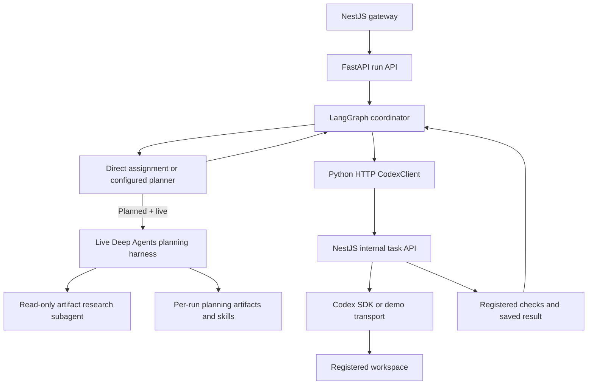
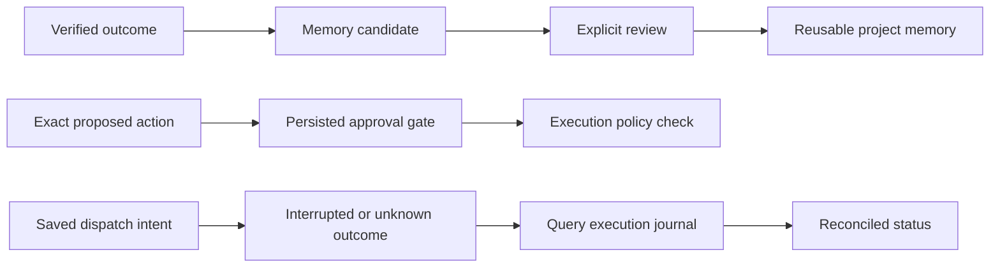

---

# LangGraph, scoped Deep Agents and Codex: implementation guide

**This lab uses Deep Agents to help prepare a plan, LangGraph to move that plan forward, and Codex to perform coding work.** These are connected layers with different responsibilities.

- **Deep Agents is scoped:** the live planner can organize work, read/write planning artifacts, consult skills and delegate bounded research. It does not receive a repository shell or unrestricted coding access.
- **LangGraph coordinates:** it advances the run, checks dependencies, persists progress and decides when to dispatch, verify, repair or wait.
- **NestJS owns Codex:** Python sends validated task assignments over HTTP; NestJS alone starts/resumes Codex threads and runs registered verification commands.
- **Demo mode is credential-free simulation:** real services, graph and persistence run, but planning and coding are deterministic fixtures. Live inference is a separate configuration and acceptance step.

This revised companion describes the implementation as inspected, not every capability proposed in the original blueprint. The [original guide](deep-agent-harness-langgraph-end-to-end-guide.md) remains unchanged. Installation commands are omitted here; see the [project README](../README.md).

## 1. Scoped Deep Agents harness

A **harness** provides a model with tools, instructions, delegation, context management and persistence. It controls which capabilities the model can use.

In this project, `DeepPlanner.build_agent()` calls `create_deep_agent()`. The resulting agent prepares a structured engineering plan inside a per-run artifact directory. It is not the component that edits the target repository.

| Capability | How this lab applies it | Boundary to remember |
| --- | --- | --- |
| Planning and to-dos | Deep Agents provides planning support; the final response must match `PlanOutput` | A model to-do list is not the authoritative execution DAG |
| Filesystem tools | Planner reads/writes notes and context in its run's planning-artifact directory | No repository filesystem or shell tool is supplied |
| Skills | Trusted `research` and `documentation` skill files are staged under `/skills/` | A skill is guidance, not a new worker or permission grant |
| Subagent delegation | The `task` tool can invoke a restricted research agent | Research reads supplied artifacts; it cannot edit code, execute commands or recursively delegate |
| Context management | SDK summarization/offload plus project middleware keep planner input bounded | Estimates are heuristic; they do not measure the coding assistant's native context window |
| Scoped coordination tools | Memory lookup/candidates and approval-request signaling | Server code binds project/run identity and enforces policy |
| Checkpointing | The live planner receives a real checkpointer and a dedicated thread key | Planner checkpoints and Codex threads are separate state |

**Features deliberately outside this scope:** a general Deep Agents coding shell, arbitrary subagent creation, automatic worktree management and unrestricted external tools. NestJS/Codex retains the coding boundary. Optional MCP/document capabilities require explicit configuration and permissions.

### Where the layers connect



- **Direct:** constructs one assignment without invoking a planner.
- **Planned, demo:** `DemoPlanner` returns `implement → verify`; it never calls Deep Agents or a model.
- **Planned, live:** `DeepPlanner` invokes the scoped harness and validates its returned plan.
- **Return path:** task status, check evidence and events travel back to Python, then through the gateway to the caller.

## 2. Request flow from start to finish

Read the boxes from top to bottom. They group related operations into one sequence; a box may span multiple scheduler turns.

```text
┌──────────────────────────────────────────────────────────────────────┐
│ RECEIVE — NestJS gateway                                              │
│ POST /api/runs carries instruction, project, preset and request key.   │
│ Gateway checks access, then forwards to FastAPI using internal auth.  │
└──────────────────────────────────────────────────────────────────────┘
                                  ↓
┌──────────────────────────────────────────────────────────────────────┐
│ REMEMBER — FastAPI + durable run store                                │
│ Validate the request; claim its identity once; save the run.          │
│ Retrieve bounded reviewed project memory for this request.            │
└──────────────────────────────────────────────────────────────────────┘
                                  ↓
┌──────────────────────────────────────────────────────────────────────┐
│ DECIDE — LangGraph + optional planner                                 │
│ Direct: make one task. Planned: obtain and validate a dependency DAG. │
│ Select a ready task; apply the approval gate before any dispatch.     │
└──────────────────────────────────────────────────────────────────────┘
                                  ↓
┌──────────────────────────────────────────────────────────────────────┐
│ HAND OFF — Python CodexClient → NestJS task API                       │
│ Save dispatch intent first, then POST /internal/v1/tasks.             │
│ NestJS validates registered workspace/checks and acquires its lease.  │
└──────────────────────────────────────────────────────────────────────┘
                                  ↓
┌──────────────────────────────────────────────────────────────────────┐
│ EXECUTE + CHECK — NestJS owns this part                               │
│ Start/resume Codex, or run the demo fixture. Persist thread/events.   │
│ Run registered checks; save evidence, status and diff references.     │
└──────────────────────────────────────────────────────────────────────┘
                                  ↓
┌──────────────────────────────────────────────────────────────────────┐
│ RECONCILE + CONTINUE — LangGraph owns this decision                    │
│ Read task status/events. Passed: unlock the next dependent task.      │
│ Failed checks: bounded repair. Unknown outcome: reconcile first.     │
│ Save verified-task memory candidates; finish when all tasks verify.   │
└──────────────────────────────────────────────────────────────────────┘
```

- **Submission is not completion.** The execution API admits a task before its coding turn finishes; later coordinator turns collect the result.
- **Same request, same identity:** unchanged duplicate submissions reuse the admitted work. Reusing an identity with a changed payload is rejected.
- **Checks decide success:** a completed Codex turn or a persuasive response alone does not finish the workflow.
- **Progress reaches the caller through two channels:** status responses show current state; replayable events explain what happened.

## 3. Implementation files and responsibilities

The table maps each responsibility to its source files. The [code map](../code-map.yaml) and [contracts](contracts.md) provide the full inventory.

| Question | Source entry points | What is implemented there |
| --- | --- | --- |
| How do requests enter? | [Node main.ts](../services/control-plane/src/main.ts), [Python api.py](../services/agent-orchestrator/src/orchestrator/api.py), [routing.py](../services/agent-orchestrator/src/orchestrator/routing.py) | Gateway/authentication, run routes, service construction and scheduler |
| What advances a run? | [workflow.py](../services/agent-orchestrator/src/orchestrator/workflow.py): `create`, `advance`, `coordinate`, `execute_task` | Graph, task selection, dispatch, reconciliation, approval and repair |
| How is a plan built? | [planning.py](../services/agent-orchestrator/src/orchestrator/planning.py): `build_agent`, `plan`, `stage_skills` | Demo/live planners, restricted research, skills and structured output |
| What can an agent call? | [tools.py](../services/agent-orchestrator/src/orchestrator/tools.py): `ScopedTools`, `MCPTools` | Bound tool scope, permissions and external capability restrictions |
| What keeps context bounded? | [context.py](../services/agent-orchestrator/src/orchestrator/context.py) | Prompt estimate, summarization observation and final input guard |
| How does Python reach Codex? | [codex_client.py](../services/agent-orchestrator/src/orchestrator/codex_client.py) | HTTP start/status/resume/cancel/events; no SDK thread ownership |
| Where does coding happen? | [execution.ts](../services/control-plane/src/execution.ts): `ExecutionService`, `SDKTransport` | Codex SDK invocation, cancellation, registered checks and diff artifacts |
| How is state retained? | [storage.py](../services/agent-orchestrator/src/orchestrator/storage.py), [store.ts](../services/control-plane/src/store.ts) | Python scoped records; Node task journal, leases and idempotent admission |
| How are logs collected? | [events.py](../services/agent-orchestrator/src/orchestrator/events.py) | Redacted event admission, replay and JSONL export |
| What validates trust decisions? | [validation.py](../services/agent-orchestrator/src/orchestrator/validation.py), [memory.py](../services/agent-orchestrator/src/orchestrator/memory.py), [workspaces.py](../services/agent-orchestrator/src/orchestrator/workspaces.py) | DAG/check validation, memory review and exact-action approval digest |
| Where are optional integrations? | [integrations.py](../services/agent-orchestrator/src/orchestrator/integrations.py), [integration_routes.py](../services/agent-orchestrator/src/orchestrator/integration_routes.py), [documents.py](../services/agent-orchestrator/src/orchestrator/documents.py) | Explicit MCP/document routes, permission checks and publication receipts |

**Library roles:** LangGraph supplies graph/checkpoint primitives; LangChain supplies model initialization and the research agent; Deep Agents supplies the planning harness; FastAPI/httpx connect Python services; NestJS and the TypeScript Codex SDK own coding execution. Dependency versions are pinned by the [Python lockfile](../services/agent-orchestrator/uv.lock) and [npm lockfile](../package-lock.json). Installed PostgreSQL-checkpointer and structlog dependencies are not the selected runtime persistence/logging pipeline.

## 4. Tool calls, delegation and handoffs

These are three different actions. Treating them separately makes the execution trace easier to read.

### Tool calls

- The live planner model chooses an exposed tool and arguments.
- The harness executes that tool and returns its result to the model's conversation.
- Filesystem tools operate under the run's artifact root: the planner can `ls`, `read_file`, `write_file`, `edit_file`, `glob` and `grep`.
- Custom coordination tools include `retrieve_project_memory`, `save_memory_candidate` and `request_approval`, subject to their permission checks.
- `ScopedTools` binds the project/run on the server, rejects model-supplied scope overrides and records redacted custom-tool activity.
- `request_approval` signals a request; it does **not** grant approval or itself implement the workflow's persisted pause.

**Example:** the planner writes a requirements note, then reads a staged skill before producing a task plan. Those actions operate on planning context; neither launches Codex.

### Research delegation

- The planner may call Deep Agents' `task` tool when research would help; delegation is not mandatory for every plan.
- The configured `general-purpose` subagent is replaced with a restricted research runnable.
- It receives its own model conversation and read-only tools: `ls`, `read_file`, `glob`, `grep`.
- It shares the run's artifact backend with the planner, so it can inspect supplied notes. Separate conversational context does not mean separate file storage.
- It returns findings to the planner, which incorporates them into the structured plan.
- It has no repository shell, write tools or recursive `task` delegation tool.

**Example:** “Read the supplied requirements and identify dependencies” is appropriate research. “Edit the service and run npm tests” belongs to the Codex execution boundary.

### Coding dispatch

- The planner returns `PlanOutput`; it does not directly start a coding thread.
- Trusted Python code fills project/run identity, risk, idempotency and execution defaults, then validates task IDs, scopes and dependency cycles.
- `WorkflowService.execute_task()` calls `CodexClient` with a validated assignment.
- NestJS admits that assignment, owns its workspace lease and invokes Codex.
- Python later receives a result containing status, thread ID, checks, artifacts, usage and any error; it decides the next workflow action.

**This handoff transfers a task contract, not an entire model conversation.** Research context, planner checkpoint state, the workflow run record and the Codex thread remain distinct.

The tool library contains an `invoke_codex_task` branch, but it is not wired as the default planner's dispatch tool. The actual execution path is the coordinator's HTTP call. Likewise, optional status/document tools require dependencies that the default planner does not receive.

## 5. LangGraph execution

The custom workflow graph is deliberately small: **`START → coordinate → END`**.

- **One application node:** planning, dispatch and verification are branches inside `coordinate()` and its helpers, not separate compiled graph nodes.
- **Two kinds of graph:** the LangGraph execution graph has one coordinator node; the engineering plan is a task dependency DAG stored as application data.
- **Small checkpoint state:** `GraphState` carries `project_id`, `run_id` and `status`. Full tasks, approvals, results and dispatch intent live in the run record.
- **Bounded advancement:** a scheduler advances active runs roughly once per second. A status GET may also advance eligible runs; it is not always a passive read.
- **Serial scheduling:** the current coordinator advances one dependency-ready task per turn. A dependency DAG does not imply parallel coding workers.
- **Explicit route:** Direct/Planned comes from the request preset; no automatic complexity classifier chooses it.

| Identifier | What it resumes or correlates |
| --- | --- |
| `project_id:run_id` | Coordinator checkpoint thread |
| `planning:project_id:run_id` | Live planner checkpoint thread |
| Codex `thread_id` | Coding conversation owned by NestJS |
| Task identity and idempotency key | Admission/reconciliation of one execution assignment |

## 6. Codex execution and credentials

### What NestJS does with the SDK

- `SDKTransport` constructs `Codex`, calls `startThread()` or `resumeThread()`, then `runStreamed()`.
- Working directory comes from the server's registered workspace, not an arbitrary caller-provided path.
- Execution selects read-only/workspace-write policy, disables workspace network access and sets `approvalPolicy: "never"`.
- NestJS saves the thread ID and selected stream metadata, then runs registered verification commands with bounded time/output.
- Checks use registered executable/argument arrays; requests cannot inject arbitrary verification commands.
- Diff artifacts capture Git diffs; they are not a complete snapshot of untracked files.
- Known failed checks can trigger up to two same-thread repair attempts. An uncertain remote outcome must be reconciled before retrying execution.

### Which mode needs which authentication?

| Path | Requirement |
| --- | --- |
| Demo planner + demo transport | No model credentials; no real model inference |
| Internal Python ↔ Node calls | Matching service bearer, separate from model authentication |
| Live Codex SDK | Codex authentication available to its process; supported ChatGPT sign-in can avoid a separate API key |
| Live Deep Agents planner | `LAB_PLANNER_MODEL`, the selected LangChain provider package and its credentials |
| Optional document/MCP operations | Separate service configuration and permissions |

- **There is no Codex-backed planner adapter in this implementation.** LangGraph can coordinate Codex through the HTTP adapter, but `DeepPlanner` still calls `init_chat_model()`.
- `langchain-openai` is not currently declared. Installing the Codex SDK alone does not configure an OpenAI LangChain model.
- Live startup constructs the planner even for Direct requests, so it currently requires planner configuration before serving them.
- The demo launcher forces demo mode; changing a parent environment flag does not turn `npm run demo` into live inference.

## 7. Planner skills and context

- **Stage trusted skills:** copy only `research` and `documentation` skill files into the run backend; reject symlinks/path escapes and files over 32,000 bytes.
- **Load guidance:** both planner and researcher receive the scoped skills location. Documentation guidance does not create a documentation worker or automatically publish anything.
- **Keep external content untrusted:** supplied artifacts and bounded visual-target metadata inform the task without granting permissions.
- **Produce a bounded plan:** structured output allows 1–16 tasks; trusted code validates dependencies and fills execution policy.

### When the planner conversation grows

- Estimate input using `ceil(serialized UTF-8 bytes / 2)`.
- Default capacity is 32,000 with 4,096 reserved; the final guard is 70% of the remainder: **19,532 estimated tokens**.
- SDK summarization starts earlier to leave space for system instructions and tool schemas; it retains the latest two messages and offloads history to the backend.
- The final request wrapper recounts system content, messages and tool schemas. If still over the guard, it refuses the call and reports that a handoff is required.
- An offload event is recorded only when a conversation-history file actually changes, with a path/hash reference.

**Limits:** this is a heuristic budget, not exact provider-token accounting. It does not inspect native Codex context occupancy or automatically create a fresh coding thread. The final guard should not be interpreted as exact accounting for every internal summarization-model call.

## 8. State, artifacts and logs

Use the actual shared `LAB_DATA_DIR`. The demo uses `.runtime`; manual service defaults differ, so configure an explicit absolute directory for both processes.

| Location under the data directory | Purpose |
| --- | --- |
| `records.sqlite` | Runs, request admissions, memory and document records; unified event ledger |
| `checkpoints.sqlite` | Coordinator and planner checkpoints |
| `control.sqlite` | Node tasks, leases, resumes and source events |
| `planning-artifacts/<project>/<run>/` | Scoped skills, planning files and offloaded conversation history |
| `artifacts/<run>/<task>/` | Service-owned Git diff artifacts |
| `events/events-*.jsonl` | Export of the unified event history |
| `workspace/result.json` | Demo fixture output |

### How logs are collected

- **Python emits workflow events:** run progress, planning, gates, reconciliation and context activity.
- **NestJS journals execution events:** task lifecycle and selected Codex item/usage metadata.
- **Python collects Node events:** it tracks the Node source cursor and adds collected events to its unified ledger.
- **EventCollector validates and redacts:** duplicate event IDs with identical original payloads reuse the stored event; changed payloads under the same ID are rejected.
- **SQLite is the durable event source:** the collector assigns a global sequence and exports redacted JSONL pages.
- **Correlation fields connect the story:** project, run, workflow, task/node, agent and thread references identify which work an event belongs to. Durations are populated where measured; zero is not a measured execution time.

### How events reach the timeline

- Python exposes event replay as JSON pages; Node polls and converts it to server-sent events (SSE).
- Node accepts a replay cursor through `Last-Event-ID` or `after`; the UI reconnects and deduplicates events.
- Node's source sequence and Python's unified sequence are different cursors. Event IDs preserve identity across collection.
- Collection uses bounded pages, including follow-up collection after a task reaches a terminal state.
- The UI keeps a bounded in-memory buffer; a visible timeline is not the full persisted history.

### Log contents and limits

- Selected Codex event types and usage are collected; raw prompts, full model output and SDK tool arguments are not copied into that stream.
- Registered checks save status/exit evidence; their stdout/stderr are not retained in the event log.
- Process stdout/stderr goes to the launching terminal; there is no automatic terminal-output log file.
- Event redaction does **not** sanitize every run record, checkpoint, history file or diff. Those local stores may contain task content.
- JSONL export currently rebuilds history on append/startup. Approximate 1 MB file rotation is not a retention policy; large histories increase export cost.
- Native Codex journals are separate; this service does not import them wholesale. Local events do not require LangSmith tracing.

## 9. Memory, approvals and recovery

These mechanisms answer three different questions: **What may we reuse? What may we execute? What do we know after an interruption?**



### Memory review

- Verified successful outcomes create candidates with source, passing-check evidence and a 30-day expiry.
- Explicit promotion requires reviewer identity and evidence metadata; it does not rerun those checks.
- Retrieval includes only reviewed, nonexpired, noninvalidated entries from the current project.
- Matching is bounded lexical search, not vector search.
- Promotion/invalidation are Python methods; a dedicated operator UI/API is not implemented.

A later task can reuse a memory candidate only after review and while it remains valid.

### Exact-action approvals

- Sensitive work persists `waiting_approval` before dispatch.
- Approval binds to an assignment digest; changing the action/revision requires fresh approval.
- Denial ends the run without coding dispatch.
- This uses application state and an approval endpoint, not LangGraph `interrupt()` / `Command(resume=...)`.
- NestJS still rejects sensitive execution: the protected-action executor is not implemented. Approval cannot create a missing execution capability.

Approval records consent for a particular action. The execution service must still support and permit it.

### Recovery after interruption

- Python saves uncertain dispatch intent **before** calling the external task API.
- On timeout or restart, it asks for existing task status instead of blindly starting another coding turn.
- Node marks unresolved execution uncertain after restart and retains its workspace lease.
- Cancellation is recorded first; requesting abort is not proof that execution has stopped.
- Known failed checks allow bounded repair. Unknown execution outcome requires reconciliation.
- Exact, parent and child workspace roots conflict under Node's lease checks; do not delete a lease to force a retry.

If a response is lost, the task may still have run. Recovery checks the execution journal; the graph checkpoint alone cannot establish what happened in the other service.

**Deployment boundary:** one Python coordinator and one Node execution owner are supported. Serial scheduling and SQLite transactions do not establish distributed or universal exactly-once execution.

## 10. Optional integrations

- Integration construction performs no network call; capabilities are denied until configured and permitted.
- Document operations need `LAB_DOCUMENT_URL` / `LAB_DOCUMENT_TOKEN`; MCP needs `LAB_MCP_URL` / `LAB_MCP_TOKEN` plus per-agent tool allowlists in `LAB_MCP_TOOLS`.
- `LAB_INTEGRATION_PERMISSIONS` enables selected publish, reconcile, search or MCP capabilities.
- Routes live under `/v1/runs/{run_id}/integrations`, require internal authentication and an existing scoped run, and are not proxied by the current browser gateway.
- MCP uses a configured HTTPS Streamable HTTP endpoint, restricted tool names, server-injected scope and no credential-bearing redirects. Returned content remains untrusted.
- Document publication journals the exact content hash before sending. Success requires a matching `READY` receipt; unknown outcomes are reconciled rather than blindly resubmitted.
- The lab document adapter has its own contract; it does not implement private login, OTP, token refresh or automatic compatibility with the workspace uploader.
- Publication is not automatic on workflow completion. Uploading this guide through the workspace's documentation tool is separate from proving the lab's application integration.

## 11. Configuration and unfinished work

Consult [.env.example](../.env.example) for the full reference. A reference file does not mean every launcher automatically loads it.

| Setting or symptom | Practical meaning |
| --- | --- |
| `LAB_INTERNAL_TOKEN` / internal 401 | Python and Node must share the service bearer; Node requires at least 16 characters |
| `LAB_BROWSER_TOKEN` | Separate live browser access token, not a provider credential |
| `LAB_DATA_DIR` | Shared absolute state root, outside model-writable workspaces for live use |
| `LAB_EXECUTION_CONFIG` | Registered project, approved root, named workspaces and checks |
| `LAB_PLANNER_MODEL` / provider import failure | Configure the provider model, adapter package and credentials |
| `LAB_CONTEXT_CAPACITY` | Planner capacity assumption; not automatically discovered from the provider |
| `CODEX_BASE_URL` / `LAB_ORCHESTRATOR_URL` | Python→Node and Node→Python service addresses |
| `LAB_PROJECT_ID` | Python recovery scope; current UI project remains `lab` |
| Unknown verification check | Plans currently default to `fixture`; real repository checks require matching integration/configuration |
| Leased workspace | Reconcile in-flight/uncertain execution before another task uses the root |
| Slow event timeline with long history | Inspect paged collection and full-history JSONL export cost |

**Still outside the delivered scope:** integration into the sibling Runtime Controller, Codex-backed planning, automatic worktree creation/merge conflict handling, selected PostgreSQL runtime and a protected-action executor.

**Still requiring live acceptance evidence:** real model/Codex execution, private document/MCP services and full browser stability. Passing fixtures do not prove these paths work with private authentication.

## 12. Tests and verification evidence

This revision is a documentation change, grounded in implementation inspection and the earlier analysis. Runtime tests are not claimed as rerun for this edit.

- **Planner tools, skills and context:** [planning/context tests](../services/agent-orchestrator/tests/test_planning_context.py) exercise actual harness construction using injected models.
- **Coordination and recovery:** [workflow tests](../services/agent-orchestrator/tests/test_workflow.py) cover DAGs, idempotency, approval, repair and verification gates.
- **Persistence and optional integration contracts:** [persistence tests](../services/agent-orchestrator/tests/test_persistence.py) cover local records/events/receipts; integration suites use controlled boundaries.
- **Execution owner:** [Node execution tests](../services/control-plane/tests/execution.test.ts) cover admission, checks, cancellation, resumes and workspace leases.
- **Service handoff:** [cross-service test](../tests/integration.test.mjs) exercises Python→Node→demo execution and verification over local HTTP.
- **Recorded results:** the [implementation summary](deep-agent-harness-implementation-summary.md) retains prior test/build evidence and limitations. Those are historical results, not newly executed checks here.

To explore behavior, compare Direct's single assignment with Planned demo's `implement → verify`. Count tasks separately from graph turns: one task can require several coordinator invocations while execution runs and results are reconciled. Graph-node events are not a count of model calls or subagents.

## Key takeaways

- Deep Agents supplies a bounded planning/research harness; only selected features are applied.
- Tool calls, research delegation and coding dispatch cross different boundaries.
- LangGraph advances durable workflow state; NestJS owns Codex threads, workspace leases and registered checks.
- Memory needs review, approval binds an exact action, and uncertainty requires reconciliation.
- Demo success proves the fixture path; live planning, coding and private integrations require their own configuration and evidence.
