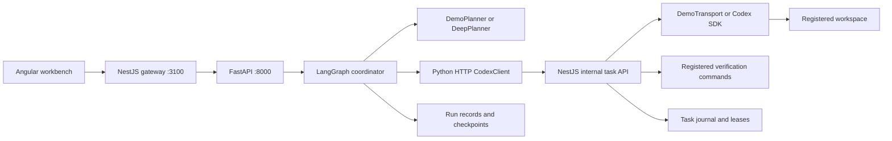
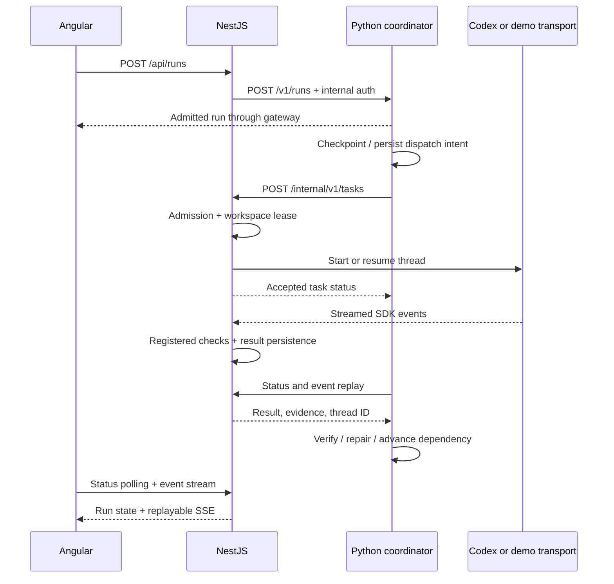
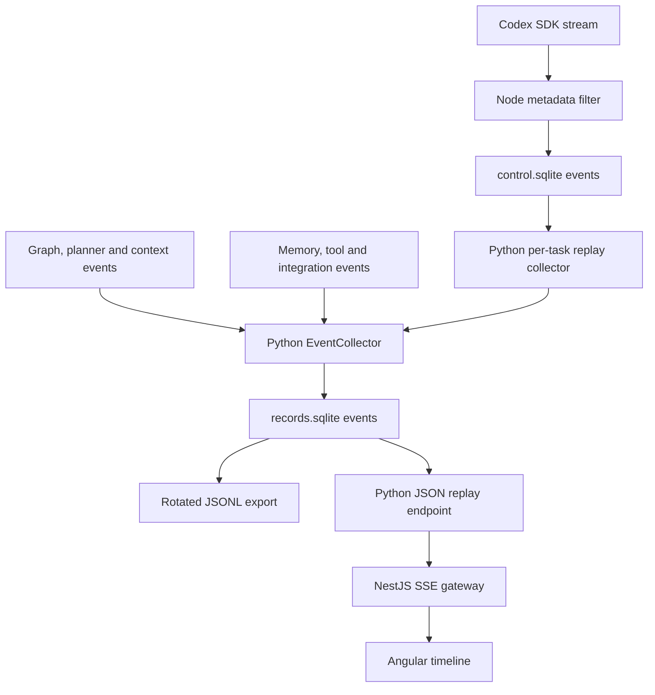

---

# LangGraph and Codex: end-to-end implementation guide

This guide explains how this lab is installed, how a request travels from Angular through LangGraph to Codex, and where execution state, logs, context and memory are stored. It describes the actual implementation in this directory, including its limitations; it does not treat every feature in the original blueprint as delivered.

The easiest starting point is `npm run demo`: it runs the real UI, HTTP services, graph, SQLite persistence and verification machinery with deterministic planning and simulated coding. Real model inference, Codex authentication and private integrations require additional configuration and acceptance testing. Source and lockfile inspection for this guide took place on 2026-10-30 America/Toronto; the implementation's earlier test evidence is identified separately below.

## 1. Understand the responsibility split

**LangGraph decides when a task can run. Codex performs the coding task. NestJS owns the Codex connection.** Deep Agents supplies the optional live planner and its bounded research/context facilities. Angular displays requests, tasks, checks and events.



The return path carries task status and verification evidence from NestJS to the coordinator, then run status and replayable events back to the browser. Python never constructs a Codex SDK client. This avoids two services trying to own the same coding thread.

This is a **standalone lab**, not a completed migration of the sibling Runtime Controller. The earlier audit found that controller owns a `codex app-server` process rather than the SDK task API assumed by the blueprint. Its sessions and source were preserved.

## 2. Install and start the existing project

Run these commands from `deep-agent-harness-with-codex-lab/`. Prerequisites are Node.js 22.13 or later, npm, uv, and a Python version satisfying `>=3.11`.

```bash
npm ci
uv sync --locked --project services/agent-orchestrator
npm run build
npm run demo
```

Expected results:

1. `npm ci` installs the Node workspace dependency versions recorded in `package-lock.json`.
2. `uv sync --locked` installs the Python package and development dependencies from `uv.lock` into `services/agent-orchestrator/.venv`.
3. `npm run build` compiles the NestJS TypeScript service and Angular application.
4. `npm run demo` starts Python on `127.0.0.1:8000` and NestJS on `127.0.0.1:3100`.
5. Open `http://127.0.0.1:3100`. The page explicitly displays **demo execution**.
6. Ctrl+C stops the two child services owned by the launcher. SQLite state remains available for the next start.

[Root package scripts](../package.json) define the npm workspaces. [scripts/demo.mjs](../scripts/demo.mjs) sets `LAB_MODE=demo`, generates an internal service token in memory, supplies a shared absolute `.runtime` directory, and disables LangSmith tracing. The token is not printed. This launcher always selects demo mode, even if the parent shell has a different `LAB_MODE`.

There is no project-specific installation command for LangGraph beyond the locked uv install. Avoid recreating the package with `uv init` or indiscriminately running `uv add` in this existing project: those are dependency-development operations, not normal setup.

### Which libraries do what?

Versions below are the inspected **lockfile snapshot**, not claims about the latest upstream release. Manifests allow ranges; the lockfiles select the reproducible versions.

| Library | Locked version | Where it is used |
| --- | --- | --- |
| `langgraph` | 1.2.19 | `workflow.py`: `StateGraph`, `START`, `END` |
| `langgraph-checkpoint-sqlite` | 3.1.3 | `workflow.py`: real local `SqliteSaver` |
| `langchain` | 1.4.7 | `planning.py`: model initialization and bounded research agent |
| `deepagents` | 0.7.32 | `planning.py`, `context.py`: planner harness, filesystem, skills, summarization |
| `fastapi` / `uvicorn` | 0.162.0 / 0.54.0 | Python API, lifecycle and HTTP server |
| `pydantic` | 2.14.2 | Validated transport and plan models |
| `httpx` | 0.28.1 | Python-to-NestJS and document service calls |
| `langchain-mcp-adapters` | 0.3.2 | Trusted MCP Streamable HTTP client |
| `langgraph-checkpoint-postgres` | 3.2.0 | Installed dependency; not selected by the current service |
| `structlog` | 26.1.0 | Declared dependency; current event pipeline is custom SQLite/JSONL, not a configured structlog pipeline |
| `@openai/codex-sdk` | 0.166.0 | NestJS `SDKTransport` |
| `@nestjs/core` | 11.2.8 | Control plane and browser gateway |
| `@angular/core` | 20.3.34 | Browser workbench |
| TypeScript | 5.9.3 | Node and Angular compilation |

Sources: [Python manifest](../services/agent-orchestrator/pyproject.toml), [uv lock](../services/agent-orchestrator/uv.lock), [control-plane manifest](../services/control-plane/package.json), [UI manifest](../apps/lab-ui/package.json), [npm lock](../package-lock.json).

For an OpenAI-backed live planner, the corresponding LangChain provider package must also be available. `langchain-openai` is not currently declared in this project. Installing LangGraph or the Codex SDK does not automatically make `init_chat_model("openai:...")` ready to use.

## 3. Navigate the implementation by responsibility

The Python package root is `services/agent-orchestrator/src/orchestrator/`.

| File | Important entry points | Responsibility |
| --- | --- | --- |
| [api.py](../services/agent-orchestrator/src/orchestrator/api.py) | `create_app`, `advance_active_runs`, `advance_active_round`, `close_service` | Startup/shutdown, dependency construction and bounded background scheduling |
| [routing.py](../services/agent-orchestrator/src/orchestrator/routing.py) | `authenticate`, `create_run`, `inspect_run`, `advance_run`, `approve_run`, `cancel_run`, `replay_events` | Authenticated workflow endpoints |
| [contracts.py](../services/agent-orchestrator/src/orchestrator/contracts.py) | `WorkflowRequest`, `TaskAssignment`, `TaskResult`, `Event` | Strict wire shapes; unknown fields are rejected |
| [workflow.py](../services/agent-orchestrator/src/orchestrator/workflow.py) | `WorkflowService.create`, `advance`, `coordinate`, `execute_task`, `approve`, `cancel`, `collect_codex_events` | Durable coordination, dependency ordering, approval, repair and reconciliation |
| [validation.py](../services/agent-orchestrator/src/orchestrator/validation.py) | `validate_plan`, `verified_result`, `direct_instruction` | DAG rules, required check evidence and bounded untrusted visual context |
| [planning.py](../services/agent-orchestrator/src/orchestrator/planning.py) | `DemoPlanner.plan`, `DeepPlanner.build_agent`, `DeepPlanner.plan`, `stage_skills` | Deterministic or model-generated plans, artifact-scoped research and skills |
| [context.py](../services/agent-orchestrator/src/orchestrator/context.py) | `ContextBudgetMiddleware`, `ObservedSummarizationMiddleware` | Final prompt guard and observation of actual SDK history offloads |
| [codex_client.py](../services/agent-orchestrator/src/orchestrator/codex_client.py) | `CodexClient.start`, `status`, `resume`, `cancel`, `events` | HTTP client; no Python SDK thread ownership |
| [workspaces.py](../services/agent-orchestrator/src/orchestrator/workspaces.py) | `action_digest` | Assignment digest for exact-action approval; not a Git worktree manager |
| [storage.py](../services/agent-orchestrator/src/orchestrator/storage.py) | `Store.claim`, `put`, `get`, `list` | Scoped records and atomic idempotency admissions |
| [events.py](../services/agent-orchestrator/src/orchestrator/events.py) | `EventCollector.append`, `emit`, `replay`, `export`, `redact` | Unified event store, redaction and JSONL export |
| [memory.py](../services/agent-orchestrator/src/orchestrator/memory.py) | `MemoryStore.save_candidate`, `promote`, `retrieve`, `invalidate` | Reviewed, expiring project knowledge |
| [tools.py](../services/agent-orchestrator/src/orchestrator/tools.py) | `ScopedTools.call`, `langchain_tools`, `MCPTools.call` | Bound coordination tools and restricted external capabilities |
| [documents.py](../services/agent-orchestrator/src/orchestrator/documents.py) | `MarkdownPublisher.publish`, `accept_receipt`, `reconcile`, `search` | Authenticated exact-revision publication |
| [integrations.py](../services/agent-orchestrator/src/orchestrator/integrations.py) | `IntegrationServices.from_env` and operation methods | Optional configured document/MCP services, default-deny policy |
| [integration_routes.py](../services/agent-orchestrator/src/orchestrator/integration_routes.py) | `publish`, `reconcile`, `search`, `call_mcp` | Explicit authenticated integration operations |
| [config.py](../services/agent-orchestrator/src/orchestrator/config.py) | `Settings`, `load_settings` | Environment configuration |

The other two application roots are:

| File | Responsibility |
| --- | --- |
| [control-plane/src/main.ts](../services/control-plane/src/main.ts) | NestJS startup, authenticated internal API, browser proxy, static UI and SSE |
| [control-plane/src/contracts.ts](../services/control-plane/src/contracts.ts) | Zod task validation, result type and scoped keys |
| [control-plane/src/store.ts](../services/control-plane/src/store.ts) | Transactional task journal, idempotency, workspace leases, event cursor |
| [control-plane/src/execution.ts](../services/control-plane/src/execution.ts) | `ExecutionService`, `SDKTransport`, `DemoTransport`, registered checks and artifacts |
| [lab-ui/src/main.ts](../apps/lab-ui/src/main.ts) | Angular `App.start`, `action`, `watch`, `readEvents`; request and result UI |
| [lab-ui/src/styles.css](../apps/lab-ui/src/styles.css) | Workbench theme, layout and responsive rules |

[code-map.yaml](../code-map.yaml) is the detailed Python function inventory; [contracts.md](contracts.md) is the shared interface reference.

## 4. Follow one request end to end

Choose **Direct** and submit a request in the UI.

1. **Angular creates a request.** `App.start()` sends `POST /api/runs` with the project, instruction, workflow preset, idempotency key, optional visual-target data and risk. An unchanged request keeps its key across an uncertain submission; the browser does not supply a shell command or filesystem root.
2. **NestJS checks the browser boundary.** `Gateway.route()` enforces the loopback host/origin policy and, in live mode, a browser bearer token. It forwards the request to Python `/v1/runs` using the separate internal token. That internal token never goes to Angular.
3. **FastAPI validates and admits the run.** `create_run()` receives `WorkflowRequest`; `WorkflowService.create()` claims the request idempotently, derives a stable run ID, retrieves a bounded set of reviewed memory and persists the initial run.
4. **A scheduling turn advances the graph.** The background scheduler runs roughly once a second. A status GET may also perform a bounded advancement for running, uncertain or cancellation-requested runs. A process-wide lock serializes graph work.
5. **The coordinator selects a task.** Direct mode produces one assignment. Planned mode asks the configured planner for a DAG, validates it and runs the first dependency-ready task. The UI preset selects the route; there is no automatic LLM complexity classifier in this version.
6. **Python saves dispatch intent before calling out.** `execute_task()` records the operation as uncertain before sending `CodexClient.start()`. A crash after this point leads to status reconciliation, not a blind new coding request.
7. **NestJS admits the execution.** `ExecutionService.start()` validates the task and registered checks/workspace. `TaskStore.admit()` atomically records it and acquires an exclusive workspace lease. Duplicate requests return the existing result; changed payloads using the same identity fail.
8. **The transport executes.** Demo mode writes `result.json` in the disposable workspace. Live mode invokes the TypeScript Codex SDK and streams events. The HTTP admission response returns before the whole coding turn finishes.
9. **Checks establish verification.** The execution service runs registered argv commands with time/output limits. A completed Codex turn alone is insufficient. Result status, checks, thread ID, usage and artifact references are persisted.
10. **Python reconciles and finishes.** Later turns read status/events, enforce required evidence, request at most two repairs if needed, unlock dependent tasks, and create a memory candidate only for a verified outcome. All tasks must pass before workflow success.
11. **The UI catches up.** Status polling updates the task rows; the event stream provides the correlated timeline. A thread identifier is an execution reference, not evidence that the same thread ID is also a LangGraph checkpoint ID.



## 5. See the actual LangGraph topology

The compiled graph in `WorkflowService.__init__()` has **one application node**:

```text
START → coordinate → END
```

`GraphState` contains `project_id`, `run_id` and `status`. `advance()` invokes that graph with checkpoint thread ID `project_id:run_id`. The fuller task DAG, approvals, results and operation intent are stored in the separate run record in `records.sqlite`.

The route/plan/dispatch/verify operations are branches inside `coordinate()` and its helpers, not distinct compiled LangGraph nodes. Each call makes bounded progress; the service scheduler supplies repeated calls. This distinction matters when reading a trace or extending the graph: the task DAG is application data, while the LangGraph execution graph is currently a single coordinator step.

Approvals likewise use persisted `waiting_approval` state plus an explicit approval endpoint. This implementation does not use LangGraph's native `interrupt()`/`Command(resume=...)` API. Checkpointing is real, but external side-effect recovery depends on the journals and status reconciliation too. LangGraph's official documentation distinguishes thread checkpoints from cross-thread stores; this project implements its own scoped record store alongside the checkpointer. [LangGraph persistence](https://docs.langchain.com/oss/python/langgraph/persistence)

## 6. Understand the Codex integration and authentication

`SDKTransport.run()` constructs `Codex`, starts a thread or resumes its saved ID, then calls `runStreamed(instruction, {signal})`. The configured working directory comes from the server workspace registry. It requests a read-only or workspace-write sandbox, disables network access for the workspace execution policy, and uses `approvalPolicy: "never"`; unsupported sensitive operations are rejected at the task boundary instead of waiting for an interactive SDK approval.

The transport observes `thread.started`, `turn.completed`, `turn.failed`, `error` and item events. It persists thread IDs and usage while sending only selected metadata to the local log. Cancellation uses an AbortController; an abort request is first recorded as `cancel_requested`. Task restart reconciliation retains uncertain leases when termination cannot be established.

The SDK controls Codex programmatically; it is not the same API as a general LangChain chat model. [Official Codex SDK documentation](https://learn.chatgpt.com/docs/codex-sdk)

| Component | Credential requirement in this lab |
| --- | --- |
| Demo planner and demo coding | No model/API credentials; deterministic behavior |
| Internal service calls | Launcher-generated bearer, unrelated to OpenAI authentication |
| Live Codex SDK | Uses Codex authentication available to its local process; eligible ChatGPT sign-in can avoid a separate OpenAI API key |
| Live Deep Agents planner | Uses `init_chat_model(LAB_PLANNER_MODEL)` and the selected provider integration/credentials |
| Optional MCP or document service | Separate configured service credentials and explicit permissions |

Codex supports ChatGPT subscription sign-in and API-key sign-in. These are distinct access paths, and ChatGPT authentication should not be copied into a generic model API client. [Codex authentication](https://learn.chatgpt.com/docs/auth)

**A Codex-backed planner is not implemented.** A future graph node could ask a read-only Codex task for a validated structured plan through NestJS. That would let LangGraph coordinate planning and coding using Codex authentication, but it requires a new adapter and acceptance tests. It would not automatically preserve every Deep Agents model/tool-call feature.

Also, live service startup currently constructs `DeepPlanner` and requires `LAB_PLANNER_MODEL` even if the first requested workflow is Direct. Direct dispatch itself skips planning; startup configuration does not yet make the live planner optional.

## 7. Follow planning, skills and context management

`DemoPlanner.plan()` returns two serial fixture tasks: `implement → verify`. `DeepPlanner.plan()` instead invokes a real Deep Agents graph and validates its structured `PlanOutput`; project/run identity, risk and idempotency keys remain server-owned.

The live planner's filesystem backend is confined to a per-run planning artifact directory. `stage_skills()` copies the selected research/documentation skill files into that scope. The planner receives explicit skills paths, filesystem context tools and planning-safe coordination tools. Its bounded general-purpose subagent is read-only research over supplied artifacts, with no repository shell. The default planned API path does not automatically enable external publishing or MCP tools in that model.

Deep Agents supplies planning, isolated subagents and filesystem-based context capabilities; the project configures these for orchestration, rather than replacing Codex's editing loop. [Deep Agents overview](https://docs.langchain.com/oss/python/deepagents/overview)

The actual context policy is in `context.py`:

```text
estimated tokens = ceil(serialized UTF-8 bytes / 2)
usable capacity = configured capacity − reserved output/headroom
final guard threshold = floor(usable capacity × 0.70)
```

Default configured capacity is 32,000; the middleware reserve is 4,096, making the guard threshold 19,532 estimated tokens. SDK summarization begins earlier, at `max(100, threshold − 8000)`, to leave room for system/tool schemas. It retains the latest two messages and offloads history using the SDK backend. The final model-call wrapper recounts system content, messages and tool schemas; if still at or above the guard threshold it refuses the call and reports that a handoff is required.

`ObservedSummarizationMiddleware` fingerprints SDK conversation-history files before and after the call. `context.offloaded` is emitted only when an actual file revision changes, with its path/hash. It does not invent an offload event just because usage is high.

This is an estimate, not a tokenizer measurement or a guarantee that every summarizer/subagent internal operation has exact provider occupancy telemetry. No automatic fresh-Codex-thread handoff is implemented. Codex owns its internal compaction. Neither cumulative SDK token usage nor the coding agents used to build this lab exposes a reliable native context percentage here.

## 8. Know where state and artifacts live

The demo shares an absolute `LAB_DATA_DIR=<project>/.runtime` between the processes. **For manual startup, set this explicitly:** Python otherwise defaults to `.lab-data`, while Node defaults to `.runtime`, relative to their respective working directories.

| Demo path | Contents and authority |
| --- | --- |
| `.runtime/records.sqlite` | Python `records` table: requests, runs, memory, document admissions and receipts; also the unified `events` table |
| `.runtime/checkpoints.sqlite` | LangGraph SQLite checkpoints; coordinator thread `project:run`, planner thread `planning:project:run` |
| `.runtime/control.sqlite` | Node `tasks`, `leases`, `resumes`, `events`; authoritative execution admission, thread mapping and workspace ownership |
| `.runtime/events/events-000000.jsonl`, subsequent numbered files | Derived redacted export of Python events, not an independent execution authority |
| `.runtime/planning-artifacts/<project>/<run>/` | Live planner's virtual files, staged skills and `conversation_history/*.md` |
| `.runtime/artifacts/<run>/<task>/changes-<uuid>.diff` | Service-owned Git diff artifacts; task results reference paths relative to `artifacts/` |
| `.runtime/workspace/result.json` | Disposable deterministic coding fixture |

The generic Python record primary key is `(namespace, project_id, key)`. `Store.claim()` uses a canonical JSON payload and a transaction: same key plus same data returns the original admission; changed data conflicts. It is not a universal exactly-once guarantee across remote services.

Git artifacts come from `git diff --no-ext-diff --binary`. They do not capture all untracked files or form a complete repository snapshot. Non-Git demo fixtures may have no diff artifact. Live execution rejects a data/artifact directory inside a model-writable workspace; workspace-controlled `.artifacts` symlinks are ignored by the trusted collector.

Codex's own thread history is separate again. The SDK manages native sessions through Codex's configured environment; these are not reconstructed from LangGraph checkpoints or imported wholesale into the event database. Do not treat the lab's `.runtime` files as a backup of Codex's entire internal context.

## 9. Understand exactly how logs are collected

There are three different log surfaces:

1. **Process output:** uvicorn access/error messages and NestJS warnings/errors appear in the launch terminal. `scripts/demo.mjs` inherits stdout/stderr; it does not automatically create a stdout log file. `structlog` being installed does not change that.
2. **Application events:** Python produces workflow/planning/context/tool events. NestJS records selected coding events. Python collects both into its SQLite event table and JSONL exports, which feed the UI.
3. **Native Codex history:** managed by Codex itself and not a substitute for graph/tool instrumentation. It cannot tell you about a Python memory lookup or graph scheduling decision that happened outside Codex.

The coding agents used to implement this project also have their own session/activity records. Those are separate from the lab application's runtime events.



The diagram's key boundary is Node's metadata filter: `ExecutionService.execute()` records SDK event type, item type and usage rather than raw prompts, tool arguments, command output or SDK error messages. Registered checks retain check ID, status and exit code; their stdout/stderr are not persisted as a separate check log.

### Event shape and examples

`contracts.Event` defines these fields; the collector adds `sequence`:

```json
{
  "event_id": "unique-event-id",
  "project_id": "lab",
  "run_id": "example-run",
  "workflow_id": "planned",
  "node_id": "coordinate",
  "agent_id": "coordinator",
  "codex_thread_id": null,
  "parent_event_id": null,
  "timestamp": "2026-10-30T20:00:00+00:00",
  "event_type": "node.completed",
  "duration_ms": 12.5,
  "status": "running",
  "metadata": {},
  "sequence": 42
}
```

This is an illustrative envelope, not a recorded run. Implemented event names include `workflow.started`, `plan.created`, `node.started`, `node.completed`, `checkpoint.saved`, `agent.delegated`, `agent.completed`, `codex.item`, `codex.result`, `memory.retrieved`, `tool.called`, `approval.requested`, `approval.decided`, `task.uncertain`, `context.recounted`, `context.offloaded`, `workflow.completed` and `workflow.error`.

Coordinate-node durations and total workflow duration are measured. Other events may have the default duration zero and no parent relationship. Event presence does not establish a full distributed trace or imply that every internal SDK subagent step has its own span.

### Persistence, deduplication and JSONL rotation

`EventCollector.append()` validates the envelope, hashes its canonical original payload, recursively redacts its stored form, inserts it and assigns an increasing SQLite sequence. An identical event ID/payload is deduplicated; conflicting content under the same ID raises an error.

`export()` rewrites numbered JSONL pages from database order under a write transaction. It writes temporary files, flushes/fsyncs them, then replaces individual pages. Startup rebuilds the export from SQLite. The default rotation target is 1,000,000 bytes; a single larger event can exceed it.

Two practical limits matter:

- This is a **rebuildable rotating export**, not an efficient append-only writer: every append currently walks the full event history.
- Rotation partitions files; it is **not a retention policy**. Replacing each file atomically does not make the whole multi-file export one atomic filesystem transaction. Use SQLite replay as the authority.

### What is—and is not—redacted

`redact()` masks secret-looking field names and recognizable credential patterns such as Bearer values and `sk-...` strings. Numeric `*_tokens` fields are preserved so usage remains useful. Memory candidates also pass through redaction.

This is pattern matching, not comprehensive sensitive-data detection. Generic `Store.put()` values, original requests/assignments, graph checkpoint messages, planning history and Git diff artifacts are not all globally sanitized. They may contain the user's instructions or source content. The implementation does not provide encryption-at-rest or automatic retention for those files. Inspect metadata first and avoid dumping raw runtime directories into another system.

## 10. Follow replay from Codex events to the browser

There are **two sequence domains**:

- Node's `control.sqlite` sequence identifies source execution events.
- Python's `records.sqlite` sequence identifies the combined workflow timeline.

`collect_codex_events()` requests up to 200 source events for a task, retains their original event IDs, removes the Node sequence, and appends them to the Python collector. It preserves the original workflow label in `metadata.source_workflow_id` while binding the unified event to the admitted workflow. Each task stores its source `event_cursor` separately.

Full pages set `event_replay_pending`. The scheduler continues draining pending pages even after a run reaches a terminal state, without restarting execution.

Python's `/v1/runs/{run_id}/events?project_id=lab&after=<cursor>` returns a bounded JSON page. NestJS `Gateway.stream()` polls that endpoint approximately every 500ms, emits SSE `id`/`data` records and heartbeat comments, and accepts either `Last-Event-ID` or an `after` query parameter.

Angular uses a fetch-based stream reader so it can send the browser bearer when needed. It reconnects with its last cursor and deduplicates by event ID. Its event buffer is about 1,000 entries, with the latest 200 matching rows displayed; the browser cursor is in memory, not durable browser storage.

Run status polling is separate and occurs approximately every 700ms. A status GET may advance running/uncertain work, so use the event endpoint or read-only SQLite when you need strictly passive inspection.

## 11. Inspect a run without exposing raw content

These are metadata-only inspection examples from the project root, for an existing demo data directory. They were checked against the source schema; this documentation task did not run them against a private user workflow. If the SQLite CLI is not installed, use a read-only database viewer or Python's `sqlite3` module.

```bash
# Which record namespaces exist, and how many entries are stored?
sqlite3 -readonly .runtime/records.sqlite \
  'SELECT namespace,project_id,count(*) FROM records GROUP BY namespace,project_id;'

# What ranges of timeline events exist for each run?
sqlite3 -readonly .runtime/records.sqlite \
  'SELECT project_id,run_id,count(*),min(sequence),max(sequence) FROM events GROUP BY project_id,run_id;'

# Inspect event names and status without dumping metadata or prompts.
sqlite3 -readonly .runtime/records.sqlite \
  "SELECT sequence,json_extract(envelope,'$.event_type'),json_extract(envelope,'$.status') FROM events ORDER BY sequence DESC LIMIT 30;"

# Inspect execution status separately from workflow state.
sqlite3 -readonly .runtime/control.sqlite \
  "SELECT project,run,json_extract(result,'$.status'),count(*) FROM tasks GROUP BY project,run,json_extract(result,'$.status');"

# View the checkpoint schema's table names, without message contents.
sqlite3 -readonly .runtime/checkpoints.sqlite '.tables'
```

Use the actual `LAB_DATA_DIR` when it differs. Do not delete a lease, checkpoint or uncertain admission to force a retry: the remote execution may still have occurred. JSONL files can be listed with `rg --files --hidden .runtime/events -g '*.jsonl'`, but avoid printing their full contents unless you have reviewed the sensitivity of that run.

## 12. Understand memory, approvals and recovery

**Memory has a review boundary.** A successfully verified task creates a candidate with its source, check evidence and a 30-day expiry. `MemoryStore.promote()` requires reviewer identity and sourced passing evidence. Retrieval excludes unreviewed, expired and invalidated entries; matching is bounded case-insensitive lexical matching, not vector search. Promotion checks the supplied evidence metadata; it does not independently rerun the command. Promotion/invalidation are Python methods, not dedicated operator UI routes in this version.

**Approval is bound to an exact action.** `action_digest()` covers the assignment data. Sensitive work waits before dispatch, and a changed revision needs fresh approval. Denial ends the run. NestJS still refuses sensitive execution because the protected executor is not implemented; approving a request cannot create that missing capability.

**Uncertainty is a state, not an automatic retry instruction.** Before an external task call, Python persists operation intent. After timeout/crash it asks for status. Node startup converts unresolved pending/running/cancellation-requested records to uncertain and retains their leases. A transport failure is different from failed verification: known failed checks can receive bounded same-thread repair; unknown execution must be reconciled first.

Workspace leases are authoritative in NestJS, even if Python is bypassed. Ancestor/descendant workspace paths conflict as well as exact matches. The supported deployment is one Python coordinator and one NestJS execution owner, with serial graph scheduling. SQLite transactions alone do not establish distributed coordinator safety.

## 13. Enable optional document and MCP operations deliberately

`IntegrationServices.from_env()` is constructed at API startup. Without explicit permissions, every external capability is denied. Construction itself performs no network call.

| Configuration | Purpose |
| --- | --- |
| `LAB_DOCUMENT_URL`, `LAB_DOCUMENT_TOKEN` | Paired document endpoint/authentication |
| `LAB_MCP_URL`, `LAB_MCP_TOKEN` | Paired trusted MCP endpoint/authentication |
| `LAB_MCP_TOOLS` | JSON mapping agent IDs to allowed remote tool-name arrays |
| `LAB_INTEGRATION_PERMISSIONS` | Comma-separated subset of `publish_markdown,reconcile_markdown,search_documents,mcp_call` |

The Python integration routes require the internal bearer and an existing project/run:

| Method | Route under `/v1/runs/{run_id}/integrations` | Operation |
| --- | --- | --- |
| POST | `/documents` | Publish one completed Markdown revision |
| GET | `/documents?project_id=...&q=...` | Search documents |
| POST | `/documents/{key}/reconcile` | Read back an uncertain publication's receipt |
| POST | `/mcp` | Invoke an allowed capability with server-bound scope |

These routes are not proxied to the browser by the current NestJS gateway. The model tool wrapper library can expose configured status/document tools, but the default planner only receives its configured planning-safe tools. The `ScopedTools.invoke_codex_task` branch is not the graph's dispatch mechanism: normal execution goes through `WorkflowService.execute_task()`; no completed workflow integration writing its `approved_assignments` namespace was found.

`MCPTools` uses the supported Streamable HTTP adapter, an exact configured HTTPS endpoint, per-agent tool allowlists, no credential-bearing redirects, and remote schemas that accept project/run scope. Server code injects scope rather than trusting the model to choose another run. External responses remain untrusted context.

`MarkdownPublisher` defines a **lab-specific contract**, not automatic compatibility with the workspace's installed Markdown uploader. It journals the content hash and uncertain state before POST, validates a matching `READY` receipt, and never blindly repeats an uncertain write. Required receipt fields include document ID, project, idempotency key and exact submitted-byte hash; S3 version is optional. Reconciliation uses authenticated GET. No login/OTP/token-refresh/device-registration flow is implemented by this adapter.

Application publication is explicit, not automatically triggered by task completion. Separately, the coding assistant can deliver this guide through the workspace's existing authenticated Work Organizer uploader; that receipt does not prove the application's publication adapter works against that same private API.

## 14. Read configuration and failure symptoms correctly

See [.env.example](../.env.example). It is a reference, not a promise that Node or the launcher automatically loads a `.env` file. Manual service launches need the variables in their process environments.

| Setting | Practical effect |
| --- | --- |
| `LAB_MODE` | Demo or live transport/planner selection; demo launcher overrides it to demo |
| `LAB_INTERNAL_TOKEN` | Must match between Python and Node; Node requires at least 16 characters |
| `LAB_BROWSER_TOKEN` | Required by live browser API access; distinct from internal/provider credentials |
| `LAB_DATA_DIR` | Shared absolute state directory; outside model-writable workspaces for live use |
| `LAB_EXECUTION_CONFIG` | Live JSON registry: project, approved root, named workspaces and checks |
| `LAB_PLANNER_MODEL` | Model/provider name passed to LangChain initialization; no Codex-planner alias exists |
| `LAB_CONTEXT_CAPACITY` | Configured planner capacity, default 32000; not automatically discovered from provider |
| `CODEX_BASE_URL` | Python's Node task endpoint base, default `http://127.0.0.1:3100` |
| `LAB_ORCHESTRATOR_URL` | Node's Python base, default `http://127.0.0.1:8000` |
| `LAB_PROJECT_ID` | Python startup recovery scope, default `lab`; Angular currently hardcodes `lab` |
| `LANGSMITH_TRACING=false` | Demo explicitly disables remote tracing; local events work independently |

Common symptoms and the relevant place to inspect:

| Symptom | Likely boundary / next check |
| --- | --- |
| UI assets missing | Build first; check `LAB_UI_DIR` and Angular build output |
| Internal 401 | Matching service bearer and Python `authenticate()` |
| Live planner import/auth error | Provider adapter package and `LAB_PLANNER_MODEL`/credentials; not a LangGraph API key |
| Unknown check / invalid assignment | Current plans default to `fixture`; real repository checks need matching registry and planner/contract support |
| Workspace already leased | In-flight or uncertain task, including an overlapping parent/child root; reconcile rather than clear blindly |
| Sensitive action remains blocked after approval | Deliberate missing protected executor, not a broken approval button |
| Workflow succeeded but no external Markdown appears | Publication is separate and default-deny; inspect explicit publication receipt |
| A large prompt refuses to run | Final context estimate remains over threshold; inspect offload events and reduce/handoff context |
| Timeline is slower with a long history | JSONL rebuild cost and paged collection; not necessarily a hung Codex turn |

The live UI/project defaults and required `fixture` check mean “set an API key and change one flag” is not a complete real-repository setup. Use a disposable approved repository and explicit configuration before any live acceptance exercise.

## 15. Verify the implementation and know what the evidence means

Reproducible checks from the project root:

```bash
npm run build
npm test
npm run test:integration
uv run --project services/agent-orchestrator ruff check \
  services/agent-orchestrator/src services/agent-orchestrator/tests
uv run --project services/agent-orchestrator pytest services/agent-orchestrator/tests -q
```

| Test file | What to learn from it |
| --- | --- |
| [test_workflow.py](../services/agent-orchestrator/tests/test_workflow.py) | DAG scheduling, restart/idempotency, approval, repairs, verification/memory gates |
| [test_planning_context.py](../services/agent-orchestrator/tests/test_planning_context.py) | Actual Deep Agents construction, tool inventory, skill loading, history offload and context guard with injected models |
| [test_http_graph.py](../services/agent-orchestrator/tests/test_http_graph.py) | Python HTTP contracts/authentication, scheduler fairness, source event replay |
| [test_persistence.py](../services/agent-orchestrator/tests/test_persistence.py) | SQLite claims, event export/redaction, memory and receipt uncertainty |
| [test_integrations.py](../services/agent-orchestrator/tests/test_integrations.py) | Optional configured service boundaries and capability permissions |
| [test_integration_routes.py](../services/agent-orchestrator/tests/test_integration_routes.py) | Route authentication/default denial with no outgoing publication |
| [execution.test.ts](../services/control-plane/tests/execution.test.ts) | Node admission, checks, resume, cancellation, overlapping leases and artifact containment |
| [integration.test.mjs](../tests/integration.test.mjs) | Actual local HTTP graph → Node → demo coding → fixture check, plus auth, replay and approval denial |

During this documentation task, the state-analysis subagent ran **52 focused Python tests successfully** in 3.26 seconds using temporary/fake boundaries. It did not run the HTTP-client test file, Node suite or browser suite. The prior implementation's final recorded evidence was 55 full Python tests, 7 Node tests, 1 cross-service test, builds and scoped browser checks; see the [implementation summary](deep-agent-harness-implementation-summary.md). Those older counts are not presented as freshly rerun here.

Still unimplemented or unverified: migration into the existing controller, a Codex-backed planner, automatic worktree creation/merge conflict handling, a selected PostgreSQL runtime, a protected-action executor, full browser stability acceptance, and live model/Codex/MCP/document end-to-end acceptance. A compiled SDK adapter or passing fake transport does not prove private authentication.

## 16. Try a small learning exercise

Run the demo and predict the difference between Direct and Planned before submitting:

- Direct should show one assignment named `direct`.
- Planned should show `implement`, then `verify` after its dependency passes.
- Both should display passed fixture evidence, while still identifying execution as simulated.
- Request approval and deny it: the run should cancel without coding dispatch. Approval alone cannot enable the missing sensitive executor.

Then compare the task count with `node.started` events. There may be multiple coordinate turns for one task because admission, execution, reconciliation and completion do not all happen in one synchronous call. This is why counting graph node events is not the same as counting agents or model calls.

Next useful topics are **Codex-backed structured planning** to remove the separate planner-provider requirement; **worktree integration** to move from serial tasks to safe concurrent coding; and **event export/retention** to make long-running histories efficient. For each, ask: which state is authoritative, which side effect can be repeated safely, and what test would prove recovery after a crash?

## Key takeaways

- Install from the lockfiles; start the demo to exercise real infrastructure without model credentials.
- The custom LangGraph graph has one coordinator node. The engineering task DAG and operation intent live in durable application records.
- NestJS alone owns Codex threads. The live Deep Agents planner currently uses a separately configured LangChain model.
- SQLite events feed JSONL and the UI, with two distinct source/unified cursors. Redacted events are not a sanitized copy of every stored artifact.
- Verified checks, exact-action approvals and uncertainty reconciliation matter more than a model saying it finished.
- The file map and tests describe delivered behavior; deferred live integrations remain explicit.
