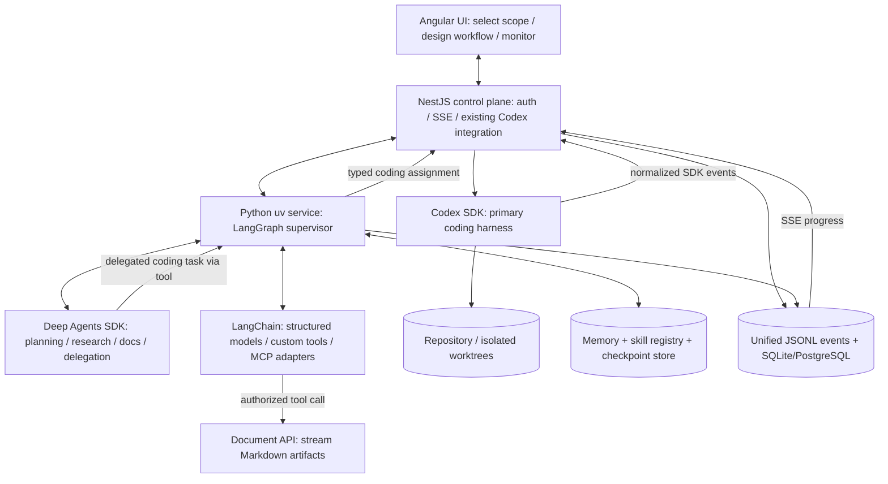
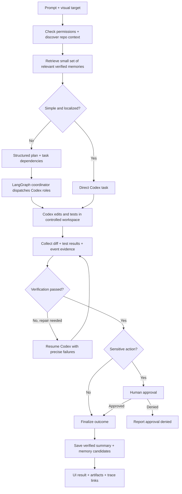
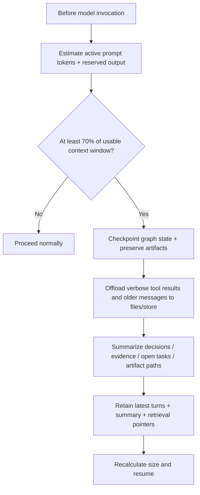

---

# Coordinating Engineering Agents with LangGraph and Codex

A coding agent can inspect a repository, change files and run tests. Coordinating several engineering tasks adds a different set of problems: deciding what runs next, preserving progress after interruption, controlling workspace access and checking whether the result meets its requirements.

This project explores that coordination layer through a standalone engineering lab built with Angular, NestJS, Python, LangGraph and Deep Agents. Its central design decision is to keep Codex responsible for code execution while the surrounding system manages assignments, evidence and recovery.

**Project scope:** a local engineering lab with a credential-free demonstration path and an optional live execution path. The current sources implement durable coordination and a Codex SDK adapter; live model execution, production operation and integration into the existing Runtime Controller are not established by this article.

## The problem: a completed agent turn is only part of the result

Consider a request to add a dashboard filter backed by an API. The interface and API need to agree on a contract. Their changes need verification. If execution stops halfway through, the coordinator needs to determine whether a task finished before sending it again.

A useful engineering workflow therefore needs more than role prompts. It needs explicit dependencies, ownership of writable files, durable task identities and a definition of success grounded in checks.

The lab separates those responsibilities. LangGraph coordinates the work. Deep Agents supports planning and bounded research. Codex performs repository work through a single NestJS-owned execution boundary. Small tasks can take a direct path; larger tasks use a dependency-aware plan.

## Architecture: one owner for code execution

The following diagram is copied unchanged from the revised engineering blueprint. It describes the **target architecture**, including extensions beyond the current local implementation.

Angular submits requests and presents progress through NestJS. The Python service coordinates assignments and calls NestJS over an authenticated internal API. NestJS creates or resumes Codex threads, tracks execution and runs registered verification commands.

This keeps the execution boundary easy to identify. A planning agent can propose work, but the coding assignment still passes through the same admission and workspace controls.

| Layer | Responsibility in the lab |
| --- | --- |
| Angular | Request controls, task dependencies, approvals and event timeline |
| NestJS | Codex SDK ownership, task admission, workspace leases, registered checks and HTTP/SSE gateway |
| Python and LangGraph | Durable coordination, dependency handling, reconciliation and bounded repair |
| Deep Agents and LangChain | Structured planning, restricted research tools and context management |
| SQLite | Local workflow checkpoints, task records, events and scoped memory |

The original blueprint assumed that the existing Runtime Controller already exposed a Codex SDK task boundary. The project audit found an app-server subprocess integration instead. The lab therefore remains isolated: it does not attach to existing controller sessions or replace that transport. Integrating it later requires an explicit ownership decision and regression checks for the existing interface and session behavior.

## From request to verified outcome

This unchanged blueprint diagram shows the intended request lifecycle:

The implementation supports direct and planned workflow choices. A planned request produces assignments with dependencies; the coordinator selects a task whose prerequisites are satisfied and records dispatch intent before calling the execution service.

Each assignment carries a project and run identity, task identity, workspace reference, instruction, verification check identifiers and risk classification. Those fields make the work explicit enough to validate and recover.

NestJS validates the assignment against registered workspaces and checks. A successful Codex turn is followed by the configured checks. Failed checks can lead to bounded repair using the saved thread. The coordinator only accepts success when the returned evidence meets its verification rules.

The diagram also includes approval and memory promotion as target stages. In the current lab, sensitive execution remains blocked at the coding adapter even after workflow approval; a dedicated protected executor is not implemented. Memory promotion is a separate reviewed action, rather than an automatic consequence of finishing a run.

## Recovery: record intent before dispatch

An interrupted request creates an important ambiguity: the caller may have lost its response while the worker continued running. Repeating the assignment immediately could duplicate an edit or another side effect.

The lab handles this by keeping workflow checkpoints and execution records separate. LangGraph retains coordination state. NestJS retains task status, Codex thread mappings and authoritative workspace leases. Python records invocation intent and reconciles task status before deciding what can happen next.

A checkpoint is therefore a recovery reference, not a backup of the repository or Codex's internal conversation. Recovery still needs the execution identity and workspace evidence.

Workspace leases enforce one writer per workspace. An uncertain execution retains its lease until reconciliation; the system does not silently release ownership to make another attempt possible. The current graph executes tasks serially. Automatic worktree creation, parallel branch integration and conflict resolution remain future work.

## Context management: preserve decisions and evidence

Long engineering runs accumulate tool output, intermediate reasoning and old messages. The blueprint proposes checkpointing, offloading and summarization before the Python agents approach their configured context limit:

The implementation uses Deep Agents summarization and history offloading, followed by a model-call guard. The guard estimates the prompt size and rejects a request that remains at or above 70% of the configured usable budget after compaction.

That percentage is an application policy based on an estimate. It is not a measured remaining-context signal from Codex. Codex retains responsibility for its own internal compaction, and its reported usage must not be interpreted as live context occupancy.

This distinction matters operationally: a coordinator can enforce a conservative policy over context it constructs, while acknowledging what it cannot observe inside another execution system.

## Memory: successful work becomes a candidate

The memory design separates reusable knowledge from execution history. A task result can produce a candidate containing its source, supporting evidence and expiry. Promotion requires explicit review and successful sourced checks.

Retrieval filters out unreviewed, expired and invalidated entries and stays within the requested project. The current implementation uses simple filtered retrieval over stored records. Vector search is an extension to evaluate when there is evidence that it improves retrieval.

A useful example is a verified repository convention discovered during an API change. That convention may help a later task. An unsupported explanation generated during a failed attempt should remain execution history until it has been checked.

## Observability across the whole workflow

Codex events describe the coding portion of a run. They cannot, by themselves, explain a planning decision, a memory lookup or a Python tool invocation.

The lab correlates workflow and execution events for a shared timeline. SQLite provides the local event record; JSONL provides a derived export. Progress reaches the Angular interface through the NestJS gateway, allowing a reader to connect task state with execution events and available evidence.

The current export rebuilds history on append, which is a scaling limitation. The supported local topology also has one Python process and one NestJS execution owner. Neither the event pipeline nor process-local scheduling locks establish distributed production readiness.

## What the demonstration shows

The credential-free demo replaces model execution with a deterministic transport. It writes a disposable workspace fixture and runs a real registered Node check. This makes the request, coordination, execution and evidence path available without a private model account.

It does not demonstrate the quality of an AI-generated implementation. The live SDK transport exists separately and needs approved authentication and configuration before live acceptance can be assessed.

| Capability | Current scope |
| --- | --- |
| Direct and planned coordination | Implemented local paths with durable records |
| Verification and repair | Registered checks and bounded repair logic |
| Codex execution | SDK adapter present; live acceptance unverified |
| Memory | Reviewed, evidence-gated, project-scoped records |
| MCP and document publishing | Optional adapters requiring trusted endpoints and matching contracts |
| PostgreSQL | Future backend integration; SQLite is the implemented local store |
| Parallel engineering | Worktree creation and merge integration remain future work |
| Existing controller integration | Separate migration, outside this lab |

This article is based on inspection of current project documentation and core sources. Runtime tests, browser checks and live model calls were not rerun during its preparation. It makes no measured claim about speed, token savings or improvement over a single-agent baseline.

## Engineering lessons

The most consequential design choice is ownership. Giving one service responsibility for Codex threads makes admission, cancellation, verification and recovery easier to reason about. Explicit task contracts give the coordinator a reliable way to exchange work without unrestricted agent conversations.

Durability also needs to match the side effect. A saved graph checkpoint cannot establish whether a remote task completed. A received event cannot establish that tests passed. An approval cannot create an executor that does not exist. Each boundary needs its own evidence.

The next useful experiments are restart recovery during an in-flight task, live acceptance of one bounded Codex assignment and comparison of direct versus planned execution on the same task. These would test reliability and coordination overhead before expanding to parallel writers.

One revealing question is: what should happen if the execution response disappears after a task starts? The design answer is to reconcile the saved identity and preserve workspace ownership until the outcome is known.

## Project sources

- [Original engineering blueprint](../../langgraph_multi_agent_harness_with_codex_engineering_lab_revised.md) — all three diagrams above are preserved verbatim, including their Mermaid syntax. The source defines no explicit color or theme overrides, so displayed colors depend on the Markdown renderer's Mermaid theme.
- [Project README](../../README.md) — local setup, live configuration and delivery boundaries.
- [Architecture](../../ARCHITECTURE.md) — service ownership, durability and implementation limits.
- [Execution boundary](../../services/control-plane/src/execution.ts) — SDK transport, task validation and registered checks.
- [Workflow coordinator](../../services/agent-orchestrator/src/orchestrator/workflow.py) — durable dispatch and reconciliation.
- [Context policy](../../services/agent-orchestrator/src/orchestrator/context.py) and [memory store](../../services/agent-orchestrator/src/orchestrator/memory.py) — context estimates and reviewed knowledge.

## Key takeaways

- Keep code execution under one clearly owned boundary.
- Coordinate work through typed assignments, dependencies and durable identities.
- Require verification evidence before reporting success.
- Treat context estimates, checkpoints and memory as distinct mechanisms.
- Establish live and recovery evidence before claiming production readiness or performance gains.
