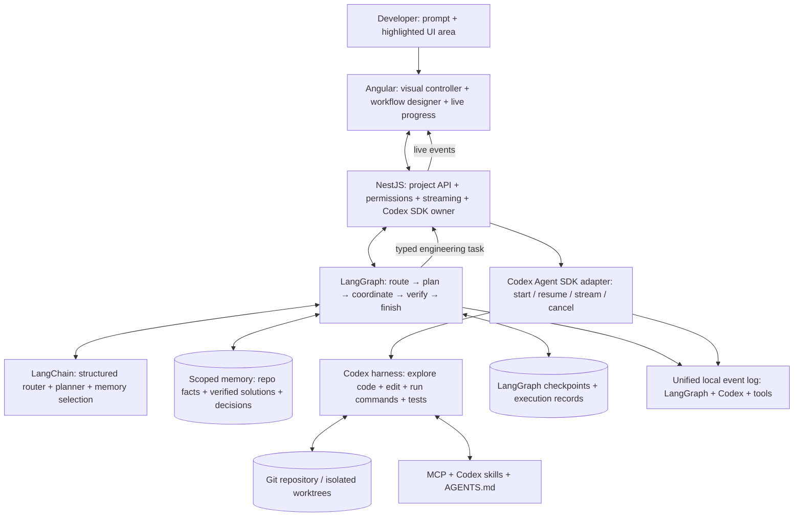
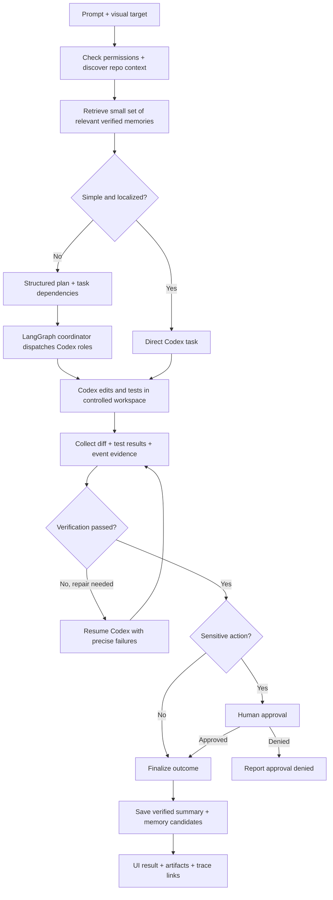
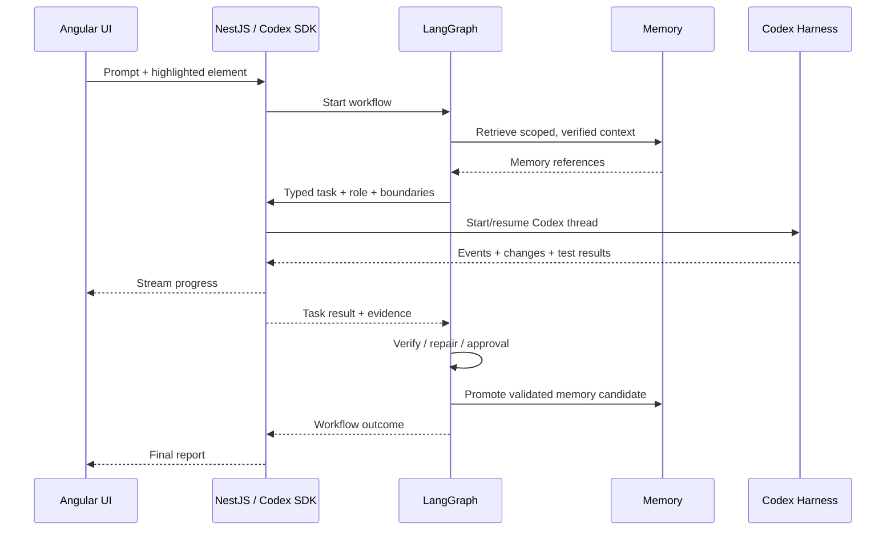
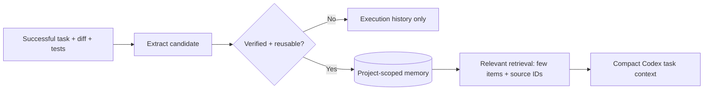
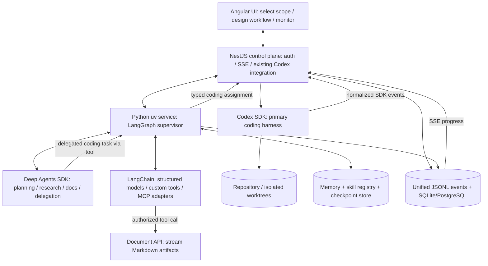
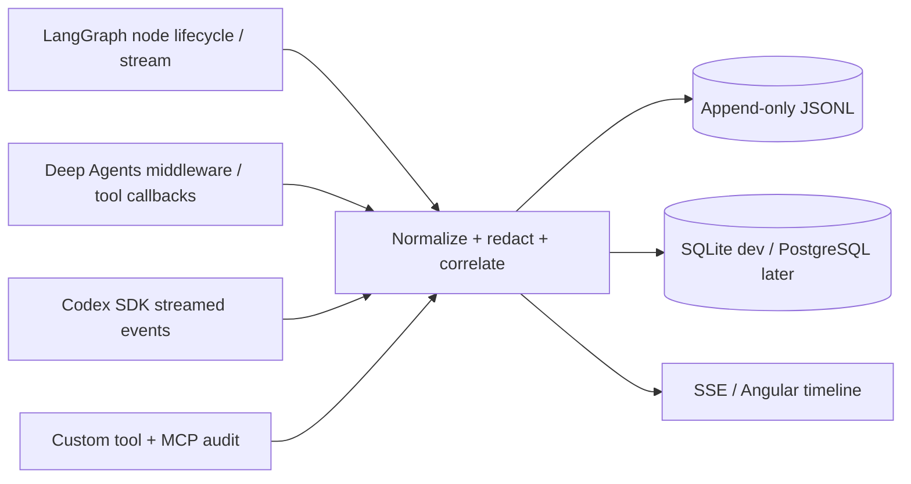
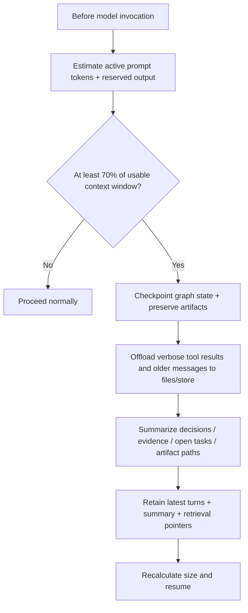

# LangGraph Multi-Agent Harness with Codex — Engineering Lab

> **Implementation blueprint | Codex-first | 30 October 2026**  
> Goal: evolve the existing Angular + NestJS controller without rebuilding its coding harness. This plan is based on the earlier README review and Codex-first architecture draft; verify current repository code and dependency versions before implementation.

## 1. The entire system at a glance



**Read this diagram top to bottom:** the user specifies *what* to change; LangGraph decides *who, when, and in what order*; Codex decides *how* to inspect, edit, and test code. NestJS remains the sole owner of the Codex SDK connection. LangChain and memory provide focused context. **Do not create a second coding harness.**

### Architecture in one minute

- **Existing Angular UI:** visual selection, natural-language tasks, workflow designer, approval screens, execution timeline.
- **Existing NestJS API:** auth, project/workspace boundaries, SDK lifecycle, event streaming, audit and policy enforcement.
- **LangGraph:** task routing, DAG dependencies, coordination, checkpoints, interrupts, retries and verification gates.
- **LangChain:** structured LLM reasoning only where useful: classify, plan, summarize, select memory.
- **Codex Agent SDK:** executes engineering tasks using Codex's existing repository, editing, terminal and testing capabilities.
- **Memory:** stores verified, scoped knowledge between runs; Codex retains its own thread context.
- **MCP / skills:** reusable capabilities exposed to Codex or the coordinator according to permissions.
- **Local observability:** LangGraph stream/callback events plus Codex SDK events, correlated in structured JSONL and SQLite/PostgreSQL; local tracing is optional, not required.
- **Deep Agents SDK:** Python planning, scoped filesystem context, skills, summarization, offloading, and subagent delegation for orchestration/research/documentation; Codex remains the only default code-editing harness.

## 2. One request, end to end



**Example:** “Highlight this Angular dashboard card; add a filter backed by a Flask API and DynamoDB query.” The router detects cross-layer work; the planner identifies UI/API/data contracts; Codex workers implement each task; verification runs tests; the coordinator merges results and records a reusable solution.

## 3. Agents and responsibilities

| Role | Implemented with | Main output |
|---|---|---|
| Router | LangChain structured output + repository rules | Direct vs planned route; affected areas; risk |
| Planner | LangChain + LangGraph node | Task DAG, contracts, acceptance checks |
| Coordinator | LangGraph state and deterministic scheduling | Safe dispatch, dependency handling, approvals |
| Frontend / API / Data / Infra worker | **Codex SDK threads**, with scoped instructions | Code diff, tests, artifacts, thread ID |
| Verifier | Deterministic test runner; optional read-only Codex review | Pass/fail evidence and repair requests |
| Memory curator | LangChain extraction + validation rules | Candidate knowledge with provenance |

**Agent communication:** use typed outputs and shared task artifacts in LangGraph state, not unrestricted peer-to-peer conversations. A worker can raise a `handoff_request`; the coordinator decides who handles it and supplies the result back to the requesting worker.



## 4. Scope, memory and context

Keep three distinct layers:

- **Codex execution context:** thread history, working directory, repository files, `AGENTS.md`, `.codex` skills and MCP settings. Codex owns this.
- **LangGraph workflow state:** tasks, dependencies, checkpoints, assignments, thread IDs, budgets, approvals and status. Durable but run-scoped.
- **Long-term knowledge:** repository map, architecture decisions, verified fixes, coding conventions, known failure patterns and prior outcomes. Project-scoped by default.



**Storage:** begin with PostgreSQL for checkpoints, metadata and keyword/filtered memory retrieval. Add `pgvector` only if retrieval evaluation shows a need. Keep large logs/diffs as artifact references, not in graph state. Record scope, source, date, validation status and expiry. Never promote unverified agent output to authoritative memory.

## 5. Codex SDK integration contract

**One SDK owner:** keep it in the existing NestJS service. LangGraph calls an authenticated internal NestJS endpoint; do not create another SDK transport in Python.

- `startTask(task)` → task ID, thread ID (when available), accepted state.
- `resumeTask(taskId, feedback)` → continue the saved Codex thread.
- `streamEvents(taskId, cursor)` → replayable progress stream.
- `interruptTask(taskId)` → request cancellation; record final state.
- `getTaskStatus(taskId)` → status, artifacts, evidence, error.

Minimal task payload:

```json
{
  "runId": "run-123",
  "taskId": "api-02",
  "projectId": "project-1",
  "role": "backend",
  "workspaceRef": "worktree/api-02",
  "instruction": "Add the filter endpoint and tests",
  "contextRefs": ["decision-12", "api-contract-01"],
  "dependsOn": ["api-contract-01"],
  "checks": ["pytest tests/api"],
  "risk": "workspace-write"
}
```

Persist the run/task/thread/workspace mapping and an invocation record **before retrying**; reconcile interrupted calls to avoid duplicate side effects. SDK event names and thread lifecycle must be validated against the installed version. Never assume LangGraph checkpointing automatically persists Codex thread state.

## 6. Tools, skills, permissions and safe parallel work

- Let **Codex** use its native tools for shell, editing, repository exploration and tests.
- Let **LangGraph** use coordination tools: memory lookup, repo metadata, task status, worktree leases, approval requests and evidence queries.
- Register **MCP** integrations once per capability where practical; enforce tool-specific scopes, authentication and audit trails.
- Preserve `AGENTS.md`, existing `.codex` skills and repository-specific conventions; avoid duplicate contradictory prompts.
- **Start serially:** one writable workspace and one Codex writer. Later add separate Git worktrees per independent task, followed by controlled integration and full-suite verification.
- Require approval for destructive operations, production deployment, credential access, external side effects and protected-branch merges.
- Keep retries bounded; report remaining failures instead of claiming completion.

## 7. Implementation roadmap

| Phase | Build | Completion check |
|---|---|---|
| **0 — Audit** | Inspect actual README/source, current Codex SDK transport, UI, sessions, tests, persistence | Existing single-agent flow works; baseline captured |
| **1 — SDK boundary** | Typed NestJS adapter, thread mapping, stream replay, resume/cancel | One task starts, streams, resumes and ends correctly |
| **2 — Graph MVP** | Router → direct Codex → verify → report; durable checkpoints | Simple visual edit succeeds without extra coding harness |
| **3 — Multi-step** | Planner, task DAG, frontend/backend/data roles, bounded repair | One Angular + API feature implemented and tested |
| **4 — Memory** | Scoped repository facts, verified outcome extraction, retrieval | Repeat task reuses relevant memory with source references |
| **5 — Visual workflows** | UI role presets, workflow templates, skills/tools, approval controls | Two configurable workflows execute end to end |
| **6 — Reliability** | Isolated worktrees, safe parallelism, merge gate, local tracing evaluations | Recovery/conflict tests pass; measured improvement vs baseline |

**Implementation choice:** first assess whether LangGraph.js inside NestJS is sufficient. Add a Python LangGraph service only if Python-specific capabilities or maintenance advantages justify the extra service boundary. Either choice must keep the Codex SDK in one place.

## 8. Validation checklist — two review passes

**Pass 1: architectural simplicity**
- [ ] Codex is the only default code-editing harness; no duplicate Deep Agents or LangChain coding loop.
- [ ] Existing Angular, NestJS, project sessions, visual context and Codex streaming remain intact.
- [ ] LangGraph orchestrates; LangChain reasons selectively; deterministic code enforces policy.
- [ ] Direct path avoids multi-agent overhead for small tasks.
- [ ] Memory complements Codex context rather than replaying all history.

**Pass 2: operational reliability**
- [ ] Persist graph checkpoints and Codex thread mappings separately; reconcile restarts.
- [ ] No concurrent writers share a worktree; integration is controlled.
- [ ] Tests, diffs and execution evidence gate success; repairs are bounded.
- [ ] Sensitive actions require policy checks and human approval.
- [ ] Track success rate, latency, token usage, memory usefulness and failure recovery against baseline.

## 9. First Codex instruction

> Read the repository README and inspect the actual source tree. Preserve the existing Angular interface, NestJS APIs, Codex integration, visual selection, sessions, streaming and work-document behavior. Implement **Phase 0 only** from this plan. Inventory current SDK usage, service boundaries, persistence, tests and dependencies; capture baseline behavior; identify the smallest changes needed for Phase 1. Do not add a new coding harness or begin implementation until the audit is reviewed.

## References

- Existing repository: https://github.com/gopalcb/agent-runtime-controller
- Codex TypeScript SDK: https://github.com/openai/codex/blob/main/sdk/typescript/README.md
- LangGraph: https://docs.langchain.com/oss/python/langgraph/overview
- LangGraph persistence: https://docs.langchain.com/oss/python/langgraph/persistence
- local tracing: https://docs.langchain.com/langsmith/home


## 12. Revised implementation decisions (Codex-first + Deep Agents SDK)

### 12.1 High-level integrated target



**Execution boundary:** Deep Agents does not replace Codex for code edits. Its planning/subagent features are used for coordinator-side work. A delegated coding request returns to LangGraph and is dispatched to Codex through the NestJS adapter; avoid nested orchestration loops.

### 12.2 Python implementation and uv

- Add `services/agent-orchestrator/` with `pyproject.toml`, `uv.lock`, `src/orchestrator/`, and `tests/`.
- Bootstrap: `uv init --package agent-orchestrator`, then `uv add langchain langgraph deepagents langgraph-checkpoint-postgres fastapi uvicorn pydantic httpx structlog` and `uv add --dev pytest pytest-asyncio ruff`.
- Add MCP client dependencies only for the selected MCP transport and server; pin and lock compatible versions. Run via `uv run uvicorn orchestrator.api:app --reload` in development.
- NestJS remains the existing Codex SDK owner. Expose typed internal `start_task`, `resume_task`, `cancel_task`, `get_task` and event-stream endpoints to Python; authenticate these service-to-service calls.
- Keep model/provider configuration and API secrets in environment variables; do not log credentials or full prompts by default.

### 12.3 Observability without LangSmith

Codex SDK events can capture **Codex** tool use, turns, file changes, and usage; they **cannot** see LangGraph decisions, Deep Agents subagent activity, memory reads, or Python tool invocations. Record all these sources in one event pipeline:



- Every event carries `run_id`, `workflow_id`, `node_id`, `agent_id`, `codex_thread_id` (when applicable), `parent_event_id`, timestamp, event type, duration, status, and redacted metadata.
- Emit `workflow.started`, `node.started`, `agent.delegated`, `codex.item`, `tool.called`, `memory.retrieved`, `context.offloaded`, `checkpoint.saved`, `approval.requested`, `node.completed`, and `workflow.completed`.
- Capture LangGraph node transitions via streaming/callbacks and explicit instrumentation; capture Codex SDK streamed events at the existing NestJS boundary; forward through the same collector.
- Start with rotating JSONL files plus SQLite indexes for local use. PostgreSQL can replace SQLite when concurrency and query needs increase. Store large raw outputs as artifact files referenced by event IDs.
- Provide run timeline, filter by agent, per-task token usage where reported, durations, errors, and link to Codex thread. Do **not** assume Codex usage events reveal remaining context-window occupancy.
- Optional future enhancement: OpenTelemetry spans with `trace_id` propagation; no mandatory LangSmith dependency.

### 12.4 Context management, 70% threshold and checkpoints



- The **70% trigger is an application policy**, not a guaranteed Deep Agents or Codex SDK setting. Calculate against configured model context capacity minus reserved output/safety headroom; prefer actual token counting when available, otherwise conservative estimation.
- Apply this policy to Python LangChain/Deep Agents contexts using middleware before model calls. Use Deep Agents built-in summarization and filesystem offloading rather than writing a second full context engine.
- For **Codex** threads, monitor SDK usage as telemetry, but do not treat cumulative usage as exact live context occupancy. Rely on Codex's own compaction; if a reliable remaining-context signal is unavailable, use a conservative handoff to a fresh Codex thread with a concise task summary and artifact references rather than claiming precise 70% enforcement.
- LangGraph checkpoints persist workflow state and pending steps, **not** full copies of the repository or Codex's internal context. Save checkpoints at important boundaries (planning, before delegation, after worker result, before approval). Store Codex thread IDs and Git commit/worktree/diff identifiers for recovery.
- Checkpoint before irreversible side effects and use idempotency keys to avoid repeating document uploads, external writes, or duplicate coding assignments on resume.

### 12.5 Scoped memory, skills, tools, MCP and Markdown streaming

- **Memory tiers:** workflow state (LangGraph checkpoint), short-term agent summaries, project-scoped facts, validated episodic solutions, and global reusable skills. Retrieval priority: current project → repository → user-approved global.
- **Memory promotion:** extract candidates after verified tasks; attach source diff/test evidence; deduplicate and allow user review before promoting to long-term memory. Keep invalidated knowledge out of retrieval.
- **Skills:** use `AGENTS.md` and Codex skills for coding conventions; use Deep Agents skills for planning/research/docs. Avoid automatically copying all skills into every prompt. Skills declare scope, triggers, and permissions.
- **Custom Python tools:** `retrieve_project_memory`, `save_memory_candidate`, `invoke_codex_task`, `get_codex_status`, `publish_markdown`, `search_documents`, `request_approval`.
- **MCP:** connect trusted MCP servers through supported adapters and configure access per agent. For existing Codex MCP tools, configure them at Codex's own tool boundary; do not proxy everything through Python unnecessarily.
- **Document streaming:** `publish_markdown` sends validated Markdown via the existing document API with `project_id`, `run_id`, `path`, `content`, `content_type`, `idempotency_key`, and optional metadata. Implement a documented API contract and authentication; do not assume these exact parameters already exist. Use chunked uploads only if the API supports them; otherwise upload the completed document and stream *progress events* separately.
- Treat MCP responses, repository files, and external documents as untrusted context; redact secrets in logs and require approvals for sensitive operations.

### 12.6 Planning and delegation without rebuilding a coding harness

- LangGraph **supervisor** decides whether the task is direct Codex execution or a multi-step graph.
- For complex tasks, a **Deep Agents planning agent** creates an explicit task list, dependencies, scope, acceptance criteria, and delegation proposals.
- **Deep Agents subagents** perform bounded research, requirements analysis, architecture review, documentation, or independent critique in isolated contexts.
- **Codex specialized workers** receive typed engineering assignments (frontend, API, data, tests) and execute within scoped worktrees or serialized access to shared files.
- Agents communicate through typed LangGraph state/results and event messages. Do not implement unrestricted peer-to-peer chatter as a prerequisite.
- QA reviews diffs, runs tests, and returns concrete failures for repair. Approval interrupts guard sensitive actions. There is no special budget-exhaustion branch in this version; terminate according to task completion, user cancellation, safety, or explicit workflow policy.

### 12.7 Revised implementation order

1. **Audit and preserve** current Angular/NestJS/Codex behavior; record current interfaces and integration tests.
2. **Python + uv service:** LangGraph state graph, internal API, schema validation, and Codex adapter calls through NestJS.
3. **Unified local logs:** capture and correlate LangGraph, Deep Agents, Codex, MCP and tool events; show them in the existing UI.
4. **Deep Agents SDK:** add planning, isolated research/documentation subagents, skills and tool permissions.
5. **Context and durability:** implement 70% middleware policy for Python agents, summarization/offloading, LangGraph checkpointing, and safe resumption.
6. **Memory and tools:** project-scoped retrieval, promotion, MCP integration, authenticated Markdown publishing, and audit trails.
7. **Multi-agent engineering:** task dependencies, Codex worker scopes, isolated worktrees, review and repair loop.
8. **End-to-end verification:** visual UI request → plan → multiple Codex tasks → QA → Markdown document API → persisted memory → complete local trace.

### 12.8 Two-pass design review

**Review 1 — architecture:** Codex stays the primary code-changing harness; Deep Agents provides orchestration-side harness capabilities only; LangGraph owns coordination; no redundant second editor, duplicate skill registry, or second Codex thread manager.

**Review 2 — reliability:** distinguish Codex logs from full workflow telemetry; use correlation IDs and redaction; enforce 70% only where context size is measurable; persist checkpoints and idempotency keys; ensure MCP/document API calls are authenticated; verify API schemas and installed package versions against current documentation before coding.

### Current reference documentation

- [Deep Agents SDK overview](https://docs.langchain.com/oss/python/deepagents/overview)
- [Codex TypeScript SDK](https://github.com/openai/codex/blob/main/sdk/typescript/README.md)
- [Codex Python SDK](https://github.com/openai/codex/blob/main/sdk/python/README.md) — an alternative if later consolidating Codex integration into Python; **not required** for the proposed NestJS-first integration.
